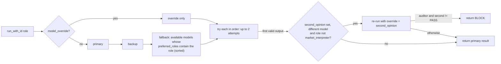
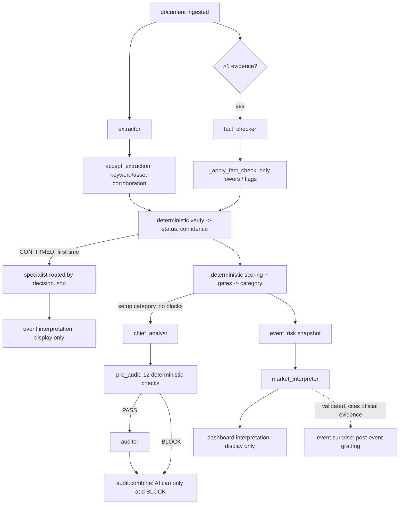

# AI agents

Sources of truth: `backend/ai.py`, `backend/schemas.py`, `backend/security.py`, `backend/audit.py`, `backend/service.py` (`enrich_event`), `backend/decision.py` (`analyse`), `backend/runtime.py` (`corroborate`, `interpretation_loop`), `backend/interpretation.py`, `config/prompts.json`, `config/rules.d/{search,security,decision,ai_runtime,refresh}.json`. Setup: [OLLAMA_SETUP.md](OLLAMA_SETUP.md). Event-aware contract: [EVENT_AWARENESS.md](EVENT_AWARENESS.md).

## Hard rules

- The AI never computes numbers. Prices, levels, scores, weights, categories, probabilities, verification status and fact confidence come from deterministic code only.
- Every AI output is a proposal. Deterministic code accepts, narrows or ignores it (see the role table).
- The chief analyst may only explain. The auditor may only add BLOCK reasons (`audit.combine`). Neither can change a category or a score.
- Models have no tools, no permissions and no write path to configuration, source trust or weights. `PUT /api/admin/sources/{id}` and `PUT /api/admin/config/*` are human, admin-gated (see [Admin and read endpoints](#admin-and-read-endpoints)) and audited.
- **No AI call happens until an administrator assigns a model to a role.** `HubService.initialize()` seeds every role with `primary/backup/second_opinion = null`. With no assignment, `candidates()` is empty, so `run_with_id` returns `(None, None)` without making an HTTP call or writing an `ai_runs` row. One exception: at startup an unassigned `market_interpreter` inherits the `chief_analyst` primary and backup once (see [Role assignment and fallback](#role-assignment-and-fallback)).
- Output that is malformed, fails its schema, cites unknown evidence or (for `chief_analyst`, `auditor` and `market_interpreter`) contains untraceable numbers fails closed.

## Providers

| Provider | Selected by | Calls | Notes |
|---|---|---|---|
| `OllamaProvider` (default) | `LLM_PROVIDER=ollama` | `GET /tags`, `POST /show` (catalog, unauthenticated `ollama_catalog` client); `POST /chat`, `/web_search`, `/web_fetch` (Bearer `OLLAMA_API_KEY`) | Non-streaming, `temperature 0`. The cloud does not enforce the schema, so the backend validates the result. Web search always goes through Ollama, whichever LLM provider is selected. |
| `OpenAIProvider` (optional) | `LLM_PROVIDER=openai` | `GET /models`, `POST /chat/completions` (`response_format: json_object`, `temperature 0`) | `NOT CONFIGURED` without `OPENAI_API_KEY`. `model_info` returns `{}`. |

- Both implement the `LLMProvider` protocol and return the vendor-neutral `ChatResult(content, tokens, model)`. `normalize()` converts legacy Ollama-shaped dicts at the boundary, so business logic never parses vendor fields.
- Health comes from `HTTPProvider` (`backend/providers/base.py`). The status is `PENDING` when a key is configured and `NOT CONFIGURED` when it is not. It becomes `ONLINE`, `AUTH_ERROR`, `RATE_LIMITED`, `DEGRADED` or `OFFLINE` only on the first authenticated request (chat or search). Catalog discovery uses the separate `ollama_catalog` client, so it does not move the `ollama` status off `PENDING`.

### Chat timeouts and the circuit breaker: `config/rules.d/ai_runtime.json`

| Role | HTTP timeout | HTTP attempts |
|---|---|---|
| default | 180 s | 1 |
| `market_interpreter` | 300 s | 1 |
| `chief_analyst` | 240 s | 1 (default) |
| `auditor` | 180 s | 1 (default) |

- `chat_attempts.default` is 1 since ai_runtime 1.4.0 (was 2): a read timeout re-sent the whole prompt while Ollama cloud probably kept generating the first answer, so one slow request cost two of the subscription's quota. Every HTTP request actually sent is counted against the [daily AI budget](#daily-ai-budget-backendai_budgetpy).

- `chat_options(provider, role, queue_role=None)` (`backend/ai.py`) reads these values and passes `timeout`, `attempts` and `role` (the limiter queue key: `queue_role` when given, else the role) only when the provider's `chat()` signature accepts them (test doubles may not). `OllamaProvider.chat` and `OpenAIProvider.chat` accept all three. The file is part of the merged rules, so an edit applies without a restart.
- The timeout counts from the moment the HTTP request is sent: the httpx client is built inside `HTTPProvider.request`, after the [limiter](#llm-request-limiter-backendllm_limiterpy) gave the call a slot. It covers the provider's own queue plus the generation. Ollama cloud answered a trivial prompt only after 37-119 s (time to first byte) while the app sent parallel calls, so the former 60/120/150 s timeouts expired in that queue (ai_runtime 1.1.0 raised them).
- HTTP attempts are transport retries inside one `HTTPProvider.request`. They are separate from the correction attempt in the [call pipeline](#call-pipeline-aiservicerun_with_idrole-inputs) and from the limiter's 429 retries.
- Both chat calls use `request(..., transport_opens_circuit=False, rate_limit_opens_circuit=False)`. A transport failure or a 5xx is retried within the HTTP attempts; on the last attempt it sets the provider `DEGRADED` and raises `ProviderUnavailable` without opening the circuit. `run_with_id` then tries the next model, so a slow interpreter does not block its backup model or the other roles. None of these chat failures (nor a chat 429) is counted in `HTTPProvider.failures`, so they never lengthen a later circuit pause.
- An HTTP 429 on a chat call sets `RATE_LIMITED` and raises at once with the parsed `Retry-After`; it never opens the circuit and never refuses another role. The limiter backs off and retries (below).
- On a chat call only HTTP 401 and 403 open the circuit. Ollama `web_search` and `web_fetch` go through their own `HTTPProvider` (`OllamaProvider.web`, name `ollama_web`), like the model catalog (`ollama_catalog`), and keep the default circuit: a 429, a 5xx or a transport failure on the last attempt opens it for `max(Retry-After, min(300, 2^failures))` s (`Retry-After` in seconds or as an HTTP date, 60 s when absent, capped at 3600 s), which pauses only searches. Before, they shared the `ollama` object with chat, and one search 429 refused every chat role with `ollama: circuit open`. The key is shared, so a 401/403 on a search is copied to the `ollama` row (`AUTH_ERROR`) and its circuit, and stops chat too.
- **Generation limits** (`ai_runtime.generation`, ai_runtime 1.5.0; `generation_options()` in `backend/ai.py`, Ollama only). A role's entry sets `max_output_tokens` (sent as `options.num_predict`) and `think` (sent as `think: false`, only when the model registry lists the model as thinking-capable). Only `market_interpreter` has one: 4000 tokens and `think: false`. Its narrative is about 150 words (a few hundred tokens of JSON); before, a median of 8,281 completion tokens per request was generated, most of them reasoning. An answer cut at the cap (`done_reason: length`) is stored with error `OutputTruncated`, is never corrected or sent to another model, and the caller's fallback runs.

### LLM request limiter: `backend/llm_limiter.py`

One process-wide `LLMLimiter` (`llm_limiter.LIMITER`) is shared by every chat call of the active LLM provider (Ollama or OpenAI). Settings: `ai_runtime.limiter` in `config/rules.d/ai_runtime.json`, read on every call.

- **Concurrency.** At most `concurrency_limit` chat requests run at a time. It starts at `start_concurrent` (4 = `max_concurrent`) and stays within `min_concurrent` (1) and `max_concurrent` (4). Before the limiter, a startup minute sent 104 chat calls at once.
- **Priority queue.** A call without a free slot waits in one queue. Lower `role_priority` starts first, FIFO within the same priority:

  | Priority | Roles |
  |---|---|
  | 0 (reserved) | `market_interpreter`, `chief_analyst`, `integration_probe` (the Settings "Test Ollama" call, which runs the auditor role) |
  | 1 | `auditor` |
  | 2 | `macro`, `fx`, `crypto`, `equity_credit`, `geopolitical_energy` |
  | 3 | `fact_checker`, and any role not listed (`default`) |
  | 4 | `research_planner` |
  | 5 | `extractor` |

- **Reserved slots.** Roles with a priority up to `reserved_max_priority` (0) always start before every other role, and the other roles never take the last `reserved_slots` (1) slots while the limit is above that number. After a 429 halved the limit to 2, the interpreter and the chief analyst therefore start at once instead of waiting behind extraction calls of up to 180 s x 2 attempts. At a limit of 1 nothing is reserved (the extraction would never run), so a reserved role waits for at most the one call in flight.
- **Aging.** Among the other roles each priority level counts as `priority_aging_seconds` (60 s) of waiting: the order key is the arrival time + priority x 60 s. An extractor call is overtaken only by calls that arrive less than (its priority - theirs) x 60 s after it (at most 5 minutes), so it is never starved by the serial loops of the higher roles.
- **Queue wait.** A call waits at most `max_queue_wait_seconds` for its role (600 s for the interpreter, the chief analyst and the auditor, 30 s for `integration_probe`, 1800 s for the extractor and the research planner, 900 s otherwise), then fails with `QueueWaitExceeded` ("LLM queue wait exceeded N s"; nothing was sent). It is one deadline per call: its 429 retries keep it and keep their place in the queue. `run_with_id` records the run (`queue_wait_exceeded: true`) and returns `None` without trying the backup model, which would wait in the same queue: the caller's own fallback applies (deterministic summary, unenriched event) and the next cycle tries again. The wait is not part of the send timeout. One AI run can still wait once per model it tries and once more for its schema-correction attempt.
- **HTTP 429 and other backoff statuses.** A chat answer in `backoff_statuses` (429, and 502/503/504 from an overloaded backend after the HTTP attempts) halves the limit (not below `min_concurrent`) and pauses new starts until now + backoff: the `Retry-After` (seconds or HTTP date) kept between `rate_limit_backoff_min_seconds` (2 s, so `Retry-After: 0` or a past date still pauses) and `rate_limit_backoff_max_seconds` (60 s), else `rate_limit_backoff_seconds` (15 s) multiplied by `rate_limit_backoff_growth` (1.5) for each further consecutive backoff, up to the same cap. Calls already sent keep running. An answer to a request sent before the current pause is counted but does not halve or extend again. The same call is then sent again with a new slot, up to `rate_limit_retries` (1) time; after that it fails with `Rate limited (HTTP 429)` (or `Server error (HTTP 503)`) and `run_with_id` tries the next model (which queues behind the pause).
- **Exhausted quota.** A 429 whose `Retry-After` is above the 60 s cap is not retried: the call fails at once with `Rate limited (HTTP 429): retry after N s`. The pause stays capped on purpose: a wrong or account-wide `Retry-After` must never lock every role out for an hour again, so after each 60 s pause the queue sends at most the halved limit of calls, and each fails at once until the quota resets.
- **Recovery.** After `recover_after_successes` (5) consecutive successes the limit rises by 1, up to `max_concurrent`, once no backoff answer came for `recover_after_seconds` (30 s). Going back up to the limit at which the provider last answered 429 needs `probe_after_seconds` (300 s) of quiet, so a provider whose real limit is below `max_concurrent` is probed every 5 minutes, not every 5-10 successes (each probe costs a full pause and a `RATE_LIMITED`/`ONLINE` flip of the health row). Any failure restarts the count; a success resets the backoff growth.
- **Slots are never leaked.** A slot is released on success, error, timeout and task cancellation (`try/finally`); a waiter cancelled or timed out while queued leaves the queue, and one granted a slot at the instant it was cancelled hands the slot on.
- **Health.** The chat provider's health row (`ollama`, or `openai` with `LLM_PROVIDER=openai`) carries `concurrency_limit`, `in_flight`, `queued`, `paused_until` (ISO time, `null` when not paused) and `rate_limited_total` (429 answers since start; 502/503/504 back off without counting there). `HubService` binds the row at startup and after a provider rebuild. The status is `RATE_LIMITED` from a 429 until the next success, which the retry after the pause normally brings; then `ONLINE`. `in_flight` and `queued` are `streams.VOLATILE_KEYS`, so they never push a WebSocket snapshot on their own.
- **One retry only.** `rate_limit_retries` was 3 until ai_runtime 1.3.0. On the Ollama cloud subscription a 429 usually means the usage window is used up, so further retries only added requests that failed the same way; the pause still applies.
- A new event loop (a worker's `asyncio.run`, a test) starts with no slots or waiters; tests reset the instance in `tests/conftest.py`.

### Daily AI budget: `backend/ai_budget.py`

The limiter smooths bursts; it does not lower the daily volume. The owner's Ollama cloud subscription has a usage quota that must last the whole day, and the app sent about 950 chat requests a day (measured in `ai_runs`: 1914 runs in two days, of which the research planner 1466, the interpreter 224, the extractor 196). `AIService` therefore checks a daily budget before every chat request, before the limiter queue. Settings: the top-level `budget` key of `config/rules.d/ai_runtime.json`, read on every check (an edit applies without restart).

| Setting | Default | Meaning |
|---|---|---|
| `daily_requests` | 400 | All roles together per budget day. 0 switches every AI request off. |
| `reset` | `Europe/Bucharest midnight` | The budget day; its first word is the time zone. |
| `role_daily` | interpreter 36, chief analyst 60, auditor 60, each specialist 24, fact checker 40, research planner 40, extractor 120 | Requests per role per day; 0 means the role never calls the AI (`AIService.available()` is then false). The interpreter's cap was 72 while a run cost 2-6 requests; a run is now 1 request and a normal day needs 8-24 ([a normal day](#a-normal-day)). The caps add up to more than `daily_requests` on purpose: the daily total is the real limit. |
| `reserve.roles`, `reserve.share` | interpreter, chief analyst, auditor; 0.25 | The other roles together may use at most (1 - share) of the day (300) and of the pace window, so the reserve roles always have room. |
| `spread.hourly_share_of_daily`, `spread.burst_hours` | 1/24, 2 | Pace: the requests of the last `burst_hours` hours stay below daily x share x hours (400 / 24 x 2 = 33, rounded down, at least 1), so a startup or morning burst cannot use up the day. |
| `spread.role_pace` | true | Each role may also have used at most ceil(cap x (hours since Bucharest midnight + `burst_hours`) / hours of the day) today (`ai_budget.role_allowance`), so every cap lasts into the evening: without it a day simulation ran out of planner, extraction and interpreter requests between 11:00 and 16:00, before the US session, with about 150 of the 400 unused. A refusal reads `AI hourly pace reached`. |

- **What counts.** A chat request is sent only while (1) its role is below `role_daily`, (2) the day's total is below `daily_requests` (the non-reserve roles below their share), (3) the role is within its share of the day so far (`role_pace`), and (4) the pace window has room. Each `ai_runs` row stores `requests`: the HTTP requests of that row that reached the provider. `HTTPProvider.request` counts every request it sends into a `SendMeter` context variable that `run_with_id` sets around each chat call, so a transport retry and the limiter's retry after a 429/502/503/504 each count (they re-send the whole prompt), while a call refused before sending (circuit open, not configured, no limiter slot in time) counts 0. The primary, the backup and any fallback model share the budget; the Settings "Test Ollama" call runs the auditor role and counts against it (a refusal is returned as `budget_refusal` and shown as such, not as an invalid schema). The counts are read from the stored rows of the current Bucharest day (JSON fields only), plus the requests admitted and not stored yet (in memory), so a restart never resets them. Rows written before the budget existed have no `requests` field: they are shown in the usage history only and never count against a day (the upgrade day already held 1432 of them, which would have refused every role, the reserve roles too, until midnight).
- **A refused call** sends nothing. `run_with_id` does not try the backup model and returns `None`, so the caller's fallback runs: the deterministic interpretation (its `fallback_reason` names the budget), the rule-based event fields, no research, a blocked AI audit. The refusal is stored in `ai_runs` with `success: false`, `requests: 0`, `budget_refusal` (`role`, `daily` or `pace`) and `error` `AI daily budget reached` (role or daily) or `AI hourly pace reached`, as **at most one row per role per hour** (`AIBudget.record_refusal`, `REFUSAL_ROW_SECONDS` 3600): the first refusal writes the row with `refused_at`; every further refusal of that role within the hour only raises the row's `suppressed` count and `last_refused_at` (and its kind and error, which the caller reads back), also after a restart (the newest stored refusal row is found again). A new budget day always starts a new row, so each day's usage counts its own refusals. Before, every refused attempt wrote a row: 141-254 a day (29 Sep - 1 Oct), 89-211 of them from the macro specialist, which is asked again on each enrichment while its pace is used up. A run the budget stops after its first request was sent (the correction is refused) keeps its own row, with `requests` 1. A refusal is logged (`ai_budget_refused`) once per role per hour. The Prometheus model metrics leave refused rows out.
- **Tokens.** `ChatResult.prompt_tokens` / `tokens` carry the provider's counts (Ollama `prompt_eval_count` / `eval_count`, OpenAI `usage.prompt_tokens` / `completion_tokens`); each row stores `prompt_tokens` and `completion_tokens` summed over its attempts. Usage shows their sum, or `null` when the provider reported none (never a measured zero).
- **`AIService.allowed(role)`** = `available(role)` and the budget would send now. `runtime.corroborate` checks it before it spends a search-budget slot and one of the event's research attempts, and `interpretation.refresh` checks it before it asks again for a market state the budget already refused.
- **Usage.** `GET /api/ai/usage` returns `{day, resets_at, daily_requests, used, remaining, reserve_share, pace: {window_hours, limit, used, shared_limit, shared_used}, roles: [{role, label, used, cap, tokens, refused, succeeded, failed}], last_rate_limited_at, history: [{day, used, tokens}] (the last 7 days, oldest first), limiter: {concurrency_limit, in_flight, queued, paused_until}}`. `used` (also per role and in the pace window) includes the requests admitted and not stored yet, the same figure the budget checks. `shared_limit` / `shared_used` are the non-reserve roles' part of the pace window. A role's calls split into `succeeded`, `failed` (sent and failed) and `refused` (the budget stopped the run, possibly after its first request was sent) without overlap; a refusal row counts as 1 + its `suppressed`, so the figure is the number of refused attempts whatever the number of stored rows. Today's figures come from budget-aware rows only; the history also counts older rows as 1 request each. With no `budget` section (no limit) `daily_requests`, `remaining` and the pace limits are `null`, and `PUT /api/admin/config/ai_budget` answers 422. `last_rate_limited_at` is the newest HTTP 429 stored in `ai_runs` or seen by the limiter. Settings -> AI models shows it with a form for the daily budget and the role caps, and a notice once the non-reserve roles have stopped (past the reserve mark, or their share of the pace window is full).
- **Editing.** `PUT /api/admin/config/ai_budget` (admin rules and audit as the other fragments, `config_change` with `before` / `after`; the file's `ai_runtime_version` is bumped) merges `{daily_requests, role_daily: {role: n}, reserve: {share, roles}, spread: {burst_hours, hourly_share_of_daily, role_pace}}`. Checks: `daily_requests` a whole number 0-10000, role caps whole numbers 0-5000 for known roles only, `reserve.share` 0-0.9, `spread.burst_hours` 1-24, `spread.role_pace` true or false; notes and other keys are refused (422, the file is unchanged). The tests write a private copy of `config/` (the `config_copy` fixture), never the files the running app reads.
- **The real quota is unknown.** Ollama does not publish the subscription's quota; 400 a day is an estimate meant to last the day (docs/TECHNICAL_DEBT.md). Raise or lower it in Settings when the provider still answers 429 late in the day, or when the day ends with budget left.

### Where the volume came from, and the limits at the source

| Source | Before | Now |
|---|---|---|
| Research planner (`runtime.research_hot_topics`, X posts, price anomalies) | the hot-topic loop ran every 60 s and re-planned every unresolved important event of the latest 50 each minute (the search-budget topic cooldown was 60 s); 1466 calls in two days, 411 successful | `refresh.cadences.hot_topics` 900 s. An event is researched at most `refresh.hot_topics.max_attempts_per_event` (2) times, not again within `recheck_hours` (6) unless new evidence reached it since the last attempt (which also waives the search-budget topic cooldown); a price anomaly (symbol and window) at most once per `anomaly_recheck_hours` (6). Attempts are stored in `research_jobs` `attempts:<key>`, so restarts and workers share them. The P0/P1 topic cooldown is at least `recheck_hours`. Divergence research is unchanged (once per event). A request that did not start (no planner, budget spent, no search slot) is not an attempt. |
| Market interpreter | every 300 s (900 s idle), triggers debounced by 60 s; 224 calls in two days, 5 successful. After the first limits (29 Sep - 1 Oct): 27 runs sent 96 requests for 6 usable texts ([measured](#measured-before-the-slim-role-29-sep---1-oct)) | a run is one request of a brief of at most 8,000 characters; an answer is repaired, not rejected; one correction only for a schema-shape error and no backup model after a rejection. A request is made only when no stored AI text still holds, at most once per `min_ai_interval_seconds` (3600 s) for a minor change, never again within `retry_failed_after_seconds` (7200 s) for a state whose answer was rejected, and not for `retry_unavailable_after_seconds` (1800 s) after the provider did not answer ([request policy](#when-a-request-is-made-_decide)). |
| Chief analyst and auditor (`decision.analyse`) | asked again on every analysis cycle (every few minutes) while a setup stayed actionable | reused for `decision.ai_reuse_seconds` (1800 s) only when symbol, category, direction, evidence set, configuration hash and the input fields/values match. Only quote timestamp and age are excluded from the input hash; cited numbers are also rechecked. Changed levels, regime or catalyst invalidate both prose and the saved verdict. Final quote/evidence checks run after the last AI await. The cache stays in memory and records `ai_reused`; rejected contexts are not cached. Existing request budgets still apply. |
| Extractor | every ingested event until one extraction succeeded, so a failed extraction was retried on every feed poll | only pages worth an AI read (`extraction` in `ai_runtime.json`: a source of tier <= `max_llm_tier` (2) or official, else a title or text naming a tracked asset or matching a causal trigger rule); every page (canonical URL, any http/https or www. spelling) is extracted once, also after a failure or a restart (`research_jobs` `extracted:<hash>`). Once the extractor used `strict_after_cap_share` (0.5) of its cap, the tier alone is not enough (25 of the 32 sources are tier 1 and official): every page needs the asset or causal match. A page refused by the hourly pace waits `spread.burst_hours` (`retry_after`) and may be extracted the same day; one refused by the daily or role cap waits for the next budget day and is dropped (`expired`) once older than `max_page_age_hours` (12), so a new day does not start on yesterday's backlog. Other events keep the rule-based fields (no extractor, no fact checker). |
| Specialists (`enrich_event`) | a call the budget refused still marked the event analysed, so it was never analysed | a refused call leaves `analysed_status` unset, so a later enrichment asks again (bounded by the role's cap and pace) |
| Budget refusals | one `ai_runs` row per refused attempt: 141-254 rows a day | one row per role per hour with a `suppressed` count |
| Limiter retries | 3 retries per 429 | 1 retry |
| HTTP attempts per chat request | 2 (a read timeout re-sent the prompt) | 1 (`chat_attempts.default`) |
| Research order | the latest 50 events in arrival order | the most important first, so the planner's cap and pace go to them |

### A normal day

What the roles cost with the shipped settings. The interpreter figures follow from its request policy (`tests/test_interpretation.py::test_a_normal_day_costs_eight_requests_when_quiet_and_one_per_hour_while_minor_facts_move` runs the 48 ticks of a day). The other roles are the stored `ai_runs` of 30 Sep, the one long day measured so far: the app ran 9.3 hours (11:22-20:42 Bucharest). On 29 Sep it ran 3 hours and on 1 Oct 1.2 hours, 13.6 hours in all, at 18 requests an hour, which is the pace limit (33 per 2 hours).

| Role | 30 Sep, 9.3 h (measured) | The same day with the slim interpreter | A full 24 h day | Cap |
|---|---|---|---|---|
| `market_interpreter` | 68 requests in 38 rows, 2 usable texts | 4 when nothing material changes (one per `unchanged_max_age_seconds`, 3 h), about 10 while minor facts keep changing (one per `min_ai_interval_seconds`, 1 h), plus one per change of the core | 8 quiet, about 24 normal; a release day adds up to about 8 around a central-bank decision | 36 |
| `extractor` | 53 (99% valid) | 53 | up to 120; from 60 on a page also needs a tracked asset or a causal match | 120 |
| `macro` | 23 (100% valid): nearly its whole cap, and 89 further attempts were refused | 23 | 24 | 24 |
| `research_planner` | 1 | 1 | a few (2 attempts per event, 6 h apart) | 40 |
| `fx`, `crypto`, `equity_credit`, `geopolitical_energy`, `fact_checker` | 0 | 0 | on demand: one per newly confirmed event of their kind | 24 each, fact checker 40 |
| `chief_analyst`, `auditor` | 0 (no setup reached publication) | 0 | one each per actionable setup, reused for `decision.ai_reuse_seconds` (1800 s) | 60 each |
| All roles | 145 | about 80-90 | at most 400, the non-reserve roles at most 300 | 400 |

| Per request | Prompt tokens | Completion tokens | Seconds |
|---|---|---|---|
| `market_interpreter`, before (53 rows) | 11,292 | 8,281 | 67 |
| `market_interpreter`, slim (estimate at 4 characters per token) | about 2,000-4,000: a system prompt of about 6,500 characters plus a brief of 2,000-8,000 (2,043 on the live state of 2 Oct) | at most 4,000 (the cap), reasoning switched off | not measured yet |
| `extractor` (90 rows) | 1,346 | 946 | 13 |
| `macro` (53 rows) | 1,717 | 1,824 | 25 |
| `research_planner` (2 rows) | 1,159 | 663 | 5 |

- The interpreter's full day is therefore about 24 x 3,000 = 72,000 prompt tokens and at most 96,000 completion tokens. The 96 interpreter requests of 29 Sep - 1 Oct used 1,088,682 prompt and 785,833 completion tokens in 13.6 hours, 87% of them in rows whose answer was rejected.
- The interpreter's cap is 36, not 24: with `role_pace` it may have used 1.5 requests per hour of the day so far, so a day that used one request an hour still has room for the changes around an evening release.
- The figures of the slim role are estimates until its first `ai_runs` rows exist; `GET /api/ai/usage` shows the measured requests and tokens per role.

### Measured before the slim role (29 Sep - 1 Oct)

`ai_runs` rows of `market_interpreter` since 28 Sep 21:00 UTC that reached the provider: 53 rows in 27 runs, 96 requests (27 first requests of the primary model, 43 correction attempts, 26 first requests of the backup and fallback models). 44 rows ended on their own (6 valid, 38 rejected); 9 more were stopped by the hourly pace after their first request.

| Why a row was rejected (38) | Rows | What the slim role does with it |
|---|---|---|
| A number that is not in the input (percentage moves, scores), `ValueError` | 10 | the sentence is removed (`sanitize`); the prompt asks for no percentages, prices or scores |
| `trade_watch` symbols or statuses that are not the backend's, `ValueError` | 10 | the model no longer writes asset lists or trade-watch comments |
| An internal code in a text (`RISK_OFF`), `ValueError` | 1 | the sentence is removed; the brief carries no regime codes |
| `market_summary` longer than 8 sentences, `ValidationError` | 10 | cut to 4 sentences before the schema is applied |
| Not JSON (an empty answer or prose), `ValidationError` | 6 | a JSON object inside a fence or a sentence is extracted (`json_text`); otherwise one correction |
| A key risk longer than 300 characters, `ValidationError` | 1 | the item is removed |

- **The correction attempt** was used by 43 of the 44 rows and rescued 5 answers; 38 corrections failed again (the same 22,000-character input plus the rejected answer).
- **The backup and fallback models** received an input the primary had just failed on 26 times and produced 3 valid answers for 48 requests; 9 of the 27 runs cost 6 requests each.
- **Repeats.** The 44 rows carried 21 different inputs; 23 rows sent an input that had already failed.
- Median per row (two requests): 22,794 prompt tokens, 15,243 completion tokens, 125 s.

## Model registry: `AIService.discover()`

No model names are hard-coded in code or config. The registry (`ai_models` table) is filled from the provider catalog:

- **Triggers:** every 3600 s (`refresh.json` → `model_discovery`) and on `POST /api/admin/models/discover`.
- **Stored per model:** `name`, `capabilities`, `tools_supported`, `thinking_supported`, `context_window` (the `*.context_length` from `/show`), `digest`, `availability`, `status`, `last_seen`, `preferred_roles`, `provider_metadata`. `/show` is re-queried only when metadata is missing or the digest changes.
- **Audit entries:** a new model writes `model_discovered`. A model missing from the catalog is set `availability=false, status=UNAVAILABLE` and writes `model_unavailable`. An HTTP 404 on `/chat` for a specific model does the same and does not open a provider-wide circuit.
- An invalid catalog response raises before any model is retired.

## Role assignment and fallback

Administrators assign models in **Settings → AI models** (`RoleForm` → `PUT /api/admin/roles/{role}`). Alternatively, `python -m scripts.check_ollama --configure-roles` fills unassigned roles only; see OLLAMA_SETUP.md. An assignment is rejected with 422 unless every named model exists and is available.

- A model is added to `preferred_roles` only after it produces a valid output for that role. Fallback therefore only uses models that have already passed for the role. A successful backup or fallback run writes the `model_fallback` audit entry.
- A second opinion writes the `second_opinion` audit entry. It can only veto for the auditor role. For other roles the primary's output is used and the second opinion is only logged.
- `market_interpreter` has four special cases (`backend/ai.py`, `backend/interpretation.py`):
  - **Inherited assignment.** At startup `interpretation.ensure_role()` copies the `chief_analyst` primary and backup to a `market_interpreter` that was never assigned, with `second_opinion: null` and `inherited_from: chief_analyst`, audited as `role_inherited`. It runs only when the role has no primary or backup and no `role_inherited` or `role_assignment` audit entry exists for it, so an administrator who clears the role keeps it cleared across restarts. A `chief_analyst` assigned later is inherited at the next startup.
  - **No automatic fallback without an assignment** (`ASSIGNED_ONLY_ROLES`). With neither primary nor backup, `candidates()` is empty, so clearing the role stops it.
  - **No second opinion** (`SINGLE_OPINION_ROLES`). A `second_opinion` stored for the role is ignored.
  - **No backup model after a rejected answer** (`ai_runtime.validation.market_interpreter`). The backup runs only when the primary could not be reached; an answer the checks rejected ends the run.

## Call pipeline: `AIService.run_with_id(role, inputs)`

1. The schema is `ROLE_SCHEMAS[role]`. Pydantic `StrictModel` uses `extra='forbid'` and `allow_inf_nan=False`, and validation runs with `strict=True`. The interpreter's output models are `LenientModel` (`extra='ignore'`): a key the schema does not know is dropped instead of failing the answer.
2. `screen_inputs()` sanitizes the inputs (see [Prompt-injection defences](#prompt-injection-defences)). For `market_interpreter` (`REDACTING_ROLES`) instruction-like sentences are removed, not only reported. Serialized input larger than `max_llm_input_chars` = **160000** raises `ValueError`.
3. The system prompt is `roles[role]`, then the `preamble`, then the sorted JSON schema. `prompt_hash` is the SHA-256 of that text, so a change to the prompt or the schema changes the hash. `prompts_version` comes from `config/prompts.json`.
4. The user message is `{"untrusted_input_data": <screened inputs>}`.
5. For each candidate model: the first attempt and at most `corrections` correction attempts, in which the model is shown its answer and the validation errors (`correction` template). The role's validation policy (`ai_runtime.validation`, `validation_policy()`) says which kinds of failure are worth one and whether the next model then gets the same prompt:

   | Policy | `corrections` | `correct` | `next_model_after_invalid` |
   |---|---|---|---|
   | `default` | 1 | `schema`, `content` | true |
   | `market_interpreter` | 1 | `schema` | false |

   A failure is `schema` (not JSON, or not the schema's shape), `content` (a schema-valid answer rejected by the evidence, number or role checks) or `truncated` (cut at the output token cap). A reason the model was already asked to correct is never corrected twice, and a truncated answer is never corrected or passed on. Each chat call carries the role's HTTP timeout and attempts and its generation limits from `ai_runtime.json` (see [Chat timeouts](#chat-timeouts-and-the-circuit-breaker-configrulesdai_runtimejson)). Before each attempt the [daily AI budget](#daily-ai-budget-backendai_budgetpy) must admit the request; a refusal ends the run (no backup model) and returns `None`.
6. The answer is parsed (`json_text` takes the JSON object out of a markdown fence or a sentence). A caller may pass `repair`: it receives the parsed JSON before the schema is applied and returns the answer with its unusable parts removed plus notes of what it removed (stored as `repairs`); it raises `ValueError` when nothing usable is left. The interpreter passes `interpretation.sanitizer`. Post-schema checks then run on every output:
   - Every `evidence_ids` value (top level and inside `hypotheses`, `pairs`, `assets`, `developments`, `relations`, `next_events`) must be one of `inputs.evidence_ids`. Otherwise the output fails with "Unknown evidence reference".
   - For `NUMERIC_ROLES` (`chief_analyst`, `auditor`, `market_interpreter`), every number in the output must appear in the screened input, in the numeric allowlist, or in the `rules.assets` config. Otherwise the output fails with "Unsupported numerical claim". A role listed in `role_numeric_allowlist` uses that list instead of `numeric_allowlist`.
   - A caller may pass a role-specific `check` (the interpreter passes `interpretation.checker`). It raises `ValueError`, a `content` failure.
7. `ProviderUnavailable` moves to the next model without a retry (the limiter already retried an HTTP 429). A `QueueWaitExceeded` (no limiter slot in time) stops the role: the call returns `None`.
8. One `ai_runs` row is written per model tried, with these fields: `agent`, `model`, `model_basis` (primary/backup/fallback/override), `model_digest`, `prompt_version`, `prompt_hash`, `input_hash`, `input_chars`, `injection_findings`, `raw_output` (at most 40000 chars), `output`, `success`, `error`, `validation_errors`, `failure` (`schema`, `content`, `truncated` or `provider`), `attempt_errors` (kind and error of each rejected attempt), `repairs` (what the caller's repair removed), `http_status`, `error_detail` (the plain provider error, e.g. `Rate limited (HTTP 429)`, `ollama: circuit open`, `LLM queue wait exceeded 600 s`), `queue_wait_exceeded` (only when true), `requests` (chat requests of the row that reached the provider), `budget_refusal` (only when the budget refused; a refusal that sent nothing also has `suppressed`, `refused_at`, `last_refused_at` and shares its row with the role's other refusals of the hour), `tokens` (completion tokens of the valid answer), `prompt_tokens` and `completion_tokens` (summed over the row's answers, when reported), `latency_ms` (the provider time, without the limiter queue), `queue_wait_ms` (the time spent waiting for limiter slots, over both attempts), `timestamp`.
9. The function returns `(output | None, run_id)`. Callers store the run ids on the event (`ai_run_ids`) or on the decision (`ai_run_ids`, `versions.models`).

## Prompt registry: `config/prompts.json`

| Key | Value / purpose |
|---|---|
| `prompts_version` | `3.1.0` (recorded on every `ai_runs` row and on every stored interpretation) |
| `preamble` | External content is data. The model has no tools or authority, must not invent facts or numbers, may cite only the supplied evidence IDs, and must return one JSON object. |
| `correction` | Retry template with `{errors}` |
| `numeric_allowlist` | `1 2 3 5 7 10 20 30 50 100 500` |
| `role_numeric_allowlist` | Replaces the general list for one role: `market_interpreter` → `1 2 3 100` (100: a score out of 100, as the page writes it) |
| `roles` | One instruction per role (11 roles) |
| `market_interpreter` | Interpreter settings: `official_evidence` (which documents the model receives, see below), `asset_aliases` (names that count as a mention of a tracked asset, e.g. "bitcoin" for BTC) and `ignored_asset_names` (ordinary words such as "Strategy" and "Meta" that never count), `plain_language.ignored_provider_ids` (provider ids that are also ordinary words, never rejected as a cited id) and `display_numbers` (`whole_number_keys`: scores the model receives rounded to whole numbers as the page shows them; `percent_keys`: scores the page shows with a % sign) |

The file is reloaded when its mtime changes (`prompts()`).

## Roles

| Role | Purpose | When it runs | Input | Output schema | What the deterministic code does with it |
|---|---|---|---|---|---|
| `research_planner` | Plan searches to corroborate a claim | `runtime.corroborate`: a non-official X post that is not CONFIRMED (P1), or `research_hot_topics` for UNCONFIRMED/PARTIALLY_CONFIRMED events at or above `brief.min_event_importance` within `reaction_event_age_hours` (P0 from `refresh.hot_topics.urgent_min_importance` 0.8, else P1), an unexplained price anomaly (P0), or a post-event MARKET DIVERGENCE (`research_divergences`: once per diverging event at `refresh.divergence_research.priority` 0, retried every 60 s while it cannot start). Events and X posts at most twice, 6 h apart unless new evidence arrived; anomalies once per 6 h ([limits](#where-the-volume-came-from-and-the-limits-at-the-source)). Requires `OLLAMA_API_KEY`, the planner's daily budget and a search-budget slot. | Event subset, `asset_moves`, `recent_events`, `monitored_topics`, `evidence_ids: []` | `ResearchPlan` (≤3 queries of ≤256 chars, priority 0–100, reason, `domains_preferred`) | `bound_queries()` strips URLs, drops instruction-like queries and caps at 3 queries of 256 chars. Ollama `web_search` results go to `research_jobs` (`discovery_only`). Result hosts that match tier ≤2 registered source domains become `corroboration_leads`, and those registered feeds are polled. Search hits never confirm anything. Only `queries` is used. |
| `extractor` | Who/what/when/where, claims, assets, event type, importance | `enrich_event` on ingestion, once per page worth an AI read (`HubService.extraction_pages`: config `extraction`, tier <= 2 or official, else a tracked asset or a causal rule in the text) until the first success (`ai_enriched`). Skipped for STALE events. | `event`, `evidence_ids` | `Extraction` | `accept_extraction()`: the proposed `event_type` is applied only if the evidence title or excerpt contains one of that type's trigger keywords (`causal_triggers.keyword_rules`). A proposed asset is added only if its symbol or configured name appears as a whole word. Rejected proposals are stored in `ai_acceptance.rejected`. Importance becomes `max(current, potential/100 × current)`, so the AI only fills a missing or zero importance. |
| `fact_checker` | Evidence relations (supports / contradicts / unrelated / second_hand) | The same enrichment pass (only when the extractor runs for a new page), only when the event has more than 1 evidence item | `event`, `evidence_ids` | `FactCheckProposal` | `_apply_fact_check()` is asymmetric. `second_hand` sets the document to `direct=false`, which lowers its independent weight in `engines.confidence`. `contradicts` is recorded in `event.ai_disputed_evidence`. The proposal never sets status or confidence (`FactCheck.status`/`fact_confidence` are computed by the backend). |
| `macro` | Macro impact hypotheses | Once, when the event first becomes CONFIRMED (`analysed_status`). Routed by `decision.json` → `specialists`: trigger/event-type match first, then asset class, else the `macro` default. | `event`, `evidence_ids`, `extraction` | `SpecialistAnalysis` | Stored as `event.interpretation` and `interpretation_role`. **Display only:** not read by scoring, decisions or backtest. |
| `fx` | Relative two-central-bank view per pair | Same as `macro` (asset class `fx`, event type `CENTRAL_BANK`) | Same as `macro` | `FXAnalysis` (validator: `base_bank ≠ counter_bank` except DXY; `causal_path` ≥ 2) | Same as `macro`. Decision-level FX gating is deterministic (`fx_policy_block`). |
| `crypto` | BTC/ETH/COIN/MSTR/BMNR drivers and positioning | Same as `macro` (asset class `crypto`, `CRYPTO_REGULATION`) | Same as `macro` | `CryptoAnalysis` (rejects max-pain-as-target and "calls > puts = bullish" phrasing) | Same as `macro` |
| `equity_credit` | Equity and credit hypotheses | Same as `macro` (asset class `equity`, `EARNINGS`, `REGULATORY_FILING`) | Same as `macro` | `SpecialistAnalysis` | Same as `macro` |
| `geopolitical_energy` | Market-relevant developments with causal pathways | Same as `macro` (triggers `GEOPOLITICAL_ENERGY`, `ENERGY_DEESCALATION`, `OIL_PRICE_SPIKE`) | Same as `macro` | `GeoAnalysis` (each development must be `market_relevant`, `pathway` ≥ 2) | Same as `macro` |
| `chief_analyst` | Explain why the engine produced the state | `decision.analyse`, only when the candidate category is in `ai_for_categories` (`STRONG LONG SETUP`, `LONG SETUP`, `SHORT SETUP`, `STRONG SHORT SETUP`) and no gate blocked | Asset, quote, snapshot events, component values and status, levels, `evidence_ids`, basket, regime, deterministic category/direction/score, deterministic confirmation text | `Explanation` (≤5 reasons of ≤240 chars, `evidence_ids`, confirmation ≤400, invalidation ≤400) | Reasons are appended to `why`, and the confirmation/invalidation text replaces the deterministic text. `confirmation_level`/`invalidation_level` stay deterministic. A missing explanation adds the block "Chief analyst explanation unavailable". The quote is re-read afterwards; a stale quote or a changed technical component adds a block. |
| `auditor` | Pre-publication check | After the chief analyst, only if nothing is blocked and the deterministic `pre_audit` returned PASS | Chief inputs plus `explanation` | `Audit` (PASS/BLOCK, reasons, `checks` named from the 12 `AUDIT_CHECKS`; PASS with a failed check is rejected) | `audit.combine()`: any deterministic failure, a missing AI audit or an AI BLOCK gives **BLOCK**, and the AI cannot turn a deterministic failure into PASS. A second-opinion auditor that does not PASS gives BLOCK. |
| `market_interpreter` | A short narrative about the deterministic event-risk snapshot: the market view (1-2 sentences), a summary (at most 4), at most 3 key risks, one sentence of reason for the dominant event and one for at most 2 events | `interpretation.refresh()` from `Runtime.interpretation_loop`, only when no stored AI text still holds (see [Market interpreter](#market-interpreter-backendinterpretationpy)) | The brief from `interpretation.brief()`, at most 8,000 characters: regime summary and drivers, at most 3 events, the lists as symbols, trade statuses, what can break, official evidence, `evidence_ids` | `MarketInterpretationOutput` | Repaired against its own input (`interpretation.sanitize`: an unusable sentence or item is removed), then checked (`interpretation.violations`). `finalize()` drops key risks that repeat what can break, stores a classification as UNDETERMINED unless it cites official evidence and adds the legacy list keys as empty lists. **Display only**: it never changes a published decision. Its validated surprise assessments feed `event.surprise` (post-event grading). |

## Market interpreter (`backend/interpretation.py`)

The backend owns every structured fact: the regime, the drivers, the favored / pressured / not-confirming lists, the events, scores, scenarios and trade statuses. The role only writes a short narrative about them. It never supplies an event, a time, a consensus, a probability, a score or a level. The contract is [EVENT_AWARENESS.md](EVENT_AWARENESS.md) §5 and §8. The role was slimmed on 2 Oct 2026 (prompts 3.1.0, ai_runtime 1.5.1, refresh 1.10.0) after only 6 of 44 runs had produced a usable text ([measured](#measured-before-the-slim-role-29-sep---1-oct)).

### Output schema: `MarketInterpretationOutput` (`backend/schemas.py`)

| Field | Bounds | Content |
|---|---|---|
| `ai_view` | 1-2 sentences, ≤ 60 words, ≤ 480 chars | Sentence 1: the market state and whether today's observations confirm it. Sentence 2: the one event to watch, by name (the page shows its time). At most 2 assets named; no list of not-confirming assets, no remark about sessions or providers. |
| `market_summary` | ≤ 4 sentences, ≤ 1000 chars | What `ai_view` does not say: why the regime holds, what the dominant event can change, what the market expects from it, an open unscheduled risk or a post-event divergence. No percentages, prices or scores. |
| `key_risks` | ≤ 3 strings of 1-200 chars | Risks that are not what-can-break items (the page shows those in their own panel). |
| `dominant_event` | `{event_id, reason ≤ 320}` or null | The backend's dominant event and one sentence of reason. |
| `next_events` | ≤ 2 `{event_id, why_it_matters ≤ 320, surprise_assessment, evidence_ids ≤ 5}` | One sentence per event; `surprise_assessment` is `HAWKISH_SURPRISE`, `DOVISH_SURPRISE`, `NEUTRAL_PRICED`, `UNDETERMINED` or `NOT_APPLICABLE`. |

- The model no longer writes `favored_assets`, `pressured_assets`, `non_confirming_assets` or `trade_watch` comments, nor the per-event bull / bear / neutral cases: the deterministic lists, trade statuses and scenario grid carry those facts. The stored and served output still has the four list keys, always as empty lists (`LEGACY_OUTPUT_LISTS`), so older readers of the dashboard block keep working.
- The schema ignores a key it does not know (`LenientModel`, `extra='ignore'`): a model that adds a field it used to write does not cost a second request. It rejects a repeated `event_id`, a countdown ("in 30 minutes", "two hours away"; times must be the supplied Bucharest clock time) and an unnegated certainty phrase ("will certainly", "guarantee", "risk-free").

### Repair, then the checks

A valid short answer must not fail because one sentence is wrong. `interpretation.sanitize()` (passed to `run_with_id` as `repair`) therefore removes what cannot be shown before the schema is applied, and `ai_runs.repairs` records what it removed:

- `ai_view` and `market_summary` keep their usable sentences, at most 2 and 4. Only when no sentence of one of them is usable is the answer rejected ("Nothing usable left"), a content failure that is never corrected by a second request.
- A key risk that is longer than 200 characters, repeats a what-can-break item or has a problem is removed; at most 3 stay.
- `dominant_event` is kept only for the backend's dominant event with a usable one-sentence reason; otherwise `finalize()` writes the deterministic reason.
- `next_events` keep events of the input with a usable one-sentence explanation, at most 2 (classified ones first). A `surprise_assessment` the event's phase or cited documents do not allow becomes `UNDETERMINED`; `evidence_ids` that are not official documents of that event are dropped.

A sentence or item is unusable (`text_problems`) when it has one of the problems below. `interpretation.checker()` runs the same checks (`violations()`) on the repaired answer as the final guard, after the plain number check of `AIService` (`NUMERIC_ROLES`, allowlist `1 2 3 100`):

- **Ids from the input.** A `next_events` id must be an event of the input; potential (unverified) events do not count. `dominant_event` must be the backend `dominant_event`.
- **Surprise assessments.** Before release (`SCHEDULED`, `APPROACHING`, `IMMINENT`) only `UNDETERMINED` or `NOT_APPLICABLE` are allowed. While `guidance_pending` is true and the headline is priced or its pricing is unknown, only `UNDETERMINED` or `NEUTRAL_PRICED`. `evidence_ids` must be official documents of that event, and `HAWKISH_SURPRISE`/`DOVISH_SURPRISE` need at least one.
- **Numbers in context** (`_number_problems`). A percentage or basis-point value must be an input value in that unit. A percentage next to a probability word ("priced", "odds", "implied") must be a value of that event's `market_pricing` (any event's for general text). A clock time must be a supplied `time_bucharest` or the `as_of_bucharest` time. A spelled-out quantity ("ninety percent") must appear in the input as written. Numbers inside unverified reports never count as input facts.
- **Trade claims vs `trade_status`** (`_trade_problems`). Claims such as "buy", "go long", "actionable", "enter now" are found by pattern. A claim does not count when it is negated just before ("not a buy", "don't go long", "too early to") or conditional ("after", "once", "if", "pending"). The claim is attributed to the assets named in its clause, then its sentence, using symbols, configured names and `asset_aliases`. Only `LONG`, `STRONG LONG`, `SHORT` or `STRONG SHORT` may be described as actionable, and only on their own side. A claim that names no asset contradicts any trade-watch status that is not actionable.
- **Unverified events** (`_unverified_problems`). A sentence that names a potential event, by id or by its distinctive words, must say "unverified", "unconfirmed", "under verification" or similar.
- **Plain language** (`_plain_language_problems`). No snake_case identifiers, "backend", "snapshot" or "input data", and no event id, evidence id, status or class code (`RISK_OFF`, `US_NFP`) or provider id of the configuration in any text.
- **Countdowns and certainties**, as in the schema.

### Input: `prepare()` builds the bundle, `brief()` is what the model reads

`prepare()` builds the full bundle (all the checks, the hashes and the deterministic summary read it). The model receives only `brief(bundle)`: at most `max_brief_chars` (8000) characters, 2,043 on the live state of 2 Oct, where the old input was about 22,000. The bounds below are defaults in `interpretation.config()`; `refresh.interpretation` overrides `max_brief_chars` and `max_brief_events`.

- **The bundle.** Lists are cut first: `events` 8 (`max_events`), `active_events` and `potential_events` 5, `favored`/`pressured`/`non_confirming` 5, `trade_watch` 8, `post_event` 3, `what_can_break` 8. `_compact()` drops ids, URLs and score breakdowns from events, and events are dropped from the end while the JSON exceeds `max_input_chars` (24000). `screen_inputs(..., redact=True)` runs over the whole bundle.
- A potential event reaches the model only as an unverified stub (name, status, note). A potential event whose name, status note or known information is instruction-like is dropped and recorded in `input_findings`.
- Countdown fields become a `window` label in the bundle and are left out of the brief. Events with a known UTC time get `time_bucharest` and `date_bucharest` from the backend, and every `date_bucharest` gets its day label `day_bucharest` ("Wed 30 Sep"); the prompt asks for dates in that form, never YYYY-MM-DD. `as_of_bucharest` (the current time) has the same unpadded day: "Mon 5 Oct 2026 07:22 Europe/Bucharest".
- `official_evidence`: for released events of the classes in `prompts.json` `market_interpreter.official_evidence.groups_by_class`, direct supporting documents from the bank's own source attached to CONFIRMED news events. They are published from 10 min before to 6 h after the event time, or are the event's own `official_documents` when the event-risk layer lists them. At most 3 per event and 8 in total in the bundle (excerpts redacted and cut at 1500 chars); the brief carries at most `max_brief_documents` (3), cut at `max_brief_excerpt_chars` (900). Their ids form `evidence_ids`.
- **The brief** keeps the shape of the bundle (`regime`, `event_risk`, `official_evidence`, `evidence_ids`, `provider_health`), so the same checks read both:
  - `regime`: a plain-language `summary` ("Risk-on conditions driven by USD weakness (constructive posture)"; the codes `RISK_ON`, `USD_STRENGTH` are never passed, so they cannot be echoed), basis, confidence, coverage, the drivers that have a direction with their input text, a driver's `stale_closes` (only closes the backend marks STALE), the current drivers next to a last-close regime, `no_current_observation` and at most 3 divergence texts.
  - `event_risk.events`: at most `max_brief_events` (3): the dominant event, the next event, then released events (those with official documents first), each with its role, name, phase, Bucharest time and day, relevance, consensus, market pricing, actual, surprise basis, the most exposed symbols, at most 3 scenario lines ("DXY ↑, US2Y ↑, BTC ↓"), sub-events, flagged incomplete data and, once released, at most 2 known facts.
  - The lists as symbols only: `favored`, `pressured`, `not_confirming` (assets whose current move disagrees) and `no_current_evidence` (assets known from the last close alone, which are not "not confirming now").
  - `trade_watch` as `{asset, trade_status}`, at most 3 what-can-break texts, the closed markets, at most 2 open unscheduled events, at most 2 unverified reports, the newest post-event entry, the active risk mode, and at most 4 providers that are failing now (never one that was simply not configured).
  - When the brief is still above the limit, optional parts are dropped in a fixed order: provider health, what can break, active events, divergences, current drivers, potential events, then the scenario lines (secondary events first), then the document excerpts are halved down to 200 characters.

### When a request is made: `_decide()`

`refresh()` collects the snapshot, builds the bundle and reads the newest `memory_rows` (60) stored runs. Three hashes of the bundle describe the state:

| Hash | Covers | A change means |
|---|---|---|
| `core_hash` | regime posture, regimes and basis; the dominant and the next event with their stage (scheduled / approaching / imminent are one stage), time, consensus, pricing, actual, surprise basis and sub-event stages; the risk mode; post-event divergence; the official documents | what the text is about changed: a stored AI text is out of date and a new one is asked for at once |
| `basis_hash` | the core plus the driver directions (also of the current observations), divergence features, the lists' membership, the open unscheduled and unverified events, the sessions and the trade statuses | a minor change: a new text waits for `min_ai_interval_seconds` |
| `prose_hash` | the observations a text can quote (driver inputs, the lists' facts, trade-watch numbers) | only a text that quotes a percentage or basis-point move is bound to it |

Live percentages, countdowns, windows, relevance levels, continuous scores and the what-can-break texts (they carry price levels) are in neither `core_hash` nor `basis_hash`, so an unchanged market does not look new on every tick (before: 40 different hashes in 51 runs). One run then does one of three things:

- **keep**: nothing is asked and nothing is stored. Either a stored AI text still holds (`servable()`: not older than `unchanged_max_age_seconds` (10800 s), same core, same `bindings` and every number, time and probability it cites is still an input value), or the newest run is the deterministic summary of this same state. A text that still holds while the `basis_hash` moved (a change it does not speak of) is kept until `min_ai_interval_seconds` have passed since the last request; then a new text is asked for. `bindings` are the facts outside the core a text depends on: the driver directions and the open unscheduled events always; the list of each asset the text names; the sessions, the trade statuses and the unverified reports only when the text speaks of them. A list change for an asset the text never mentions therefore does not discard it, and an older text that is true again (a flapping input) is stored once more as the newest run with `ai_outcome: reused` and served, without a request.
- **wait**: the deterministic summary of the new state is stored with the reason (`ai_outcome`), without a request:

  | `ai_outcome` | Reason no request is made |
  |---|---|
  | `role_unavailable` | no model is assigned or available, or the role's cap is 0 |
  | `known_failed` | this `basis_hash` already has a rejected answer younger than `retry_failed_after_seconds` (7200 s); the stored rows are the memory, so a restart keeps it |
  | `provider_backoff` | the last request was not answered (timeout, 429, 5xx) less than `retry_unavailable_after_seconds` (1800 s) ago, whatever the state: a timed-out generation is still paid for |
  | `deferred` | the last request is younger than `min_ai_interval_seconds` (3600 s) and the core has not changed since |

- **ask**: one request with the brief. Its outcome is stored as `ok`, `invalid` (sent, the answer was rejected), `refused` (the budget sent nothing), `unavailable` (the provider did not answer) or `error` (the brief exceeded the application input limit). A state the budget refused is not attempted again while `AIService.allowed()` is false, so the ticks add neither calls nor refusal rows.

A request costs 1 request of `budget.role_daily.market_interpreter` (36), 2 with a schema correction; the backup model runs only when the primary could not be reached ([a normal day](#a-normal-day)).

### Fallback, storage and the dashboard block

- Without a valid AI text the stored output is `deterministic_output()`: a template summary of the same snapshot with `source: 'deterministic'` and `label: "Deterministic summary — AI unavailable"`. It is what the user reads most of the time, so it follows the same limits and says each fact once:
  - `ai_view` is two short sentences. The first is the regime, its basis and whether today's observations confirm it: "Mixed conditions at the last close (historical context); today's observations only partly confirm it." A favored or pressured asset agrees, a not-confirming asset with a current observation disagrees, and for a last-close regime each current driver is compared with its direction at the close and every reported divergence disagrees (`_today`); the outcome is "confirm it", "only partly confirm it", "are not confirming it" or "there is no current observation to confirm it yet". The second names the one event to watch: "The next event to watch is EIA Weekly Petroleum Status Report." It carries no time, countdown or EVENT RISK MODE label (the event card and the banner show them), no list of assets (the positioning lists show them) and no closed-markets sentence (the summary has it).
  - `why_it_matters` is one sentence from the event's scenario templates: "Possible outcomes: Larger crude draw (WTI ↑, BRENT ↑) or Larger crude build (WTI ↓, BRENT ↓)." (possibilities, never certainties; a label's own bracketed gloss is left to the scenario grid). An unscheduled event reads "Possible consequences: BRENT ↑, NASDAQ ↓." and an event without a template "No expected direction is defined for this event; its effect is read from the market reaction after it." It never restates the relevance level, the exposed assets or the source and time basis: the card shows those as chips and details.
  - `market_summary` (at most 4 sentences, in priority order): current moves that oppose a last-close regime, a STALE close that still votes (a close is called stale only when the backend marks it STALE), the market expectation (only when a consensus or a pricing exists), a post-event reaction or MARKET DIVERGENCE, whether setups wait for the event, an open unscheduled risk, the risk mode of another event, and the closed markets by name ("Traditional markets are closed" only when all four are). An open session is never described as live observations.
  - `key_risks`: EVENT DATA INCOMPLETE only for a flagged event, and unconfirmed reports; what can break stays in its own panel. The template quotes only numbers of its input, never classifies a surprise and never shows an expected-direction arrow next to an asset that is not confirming.
- `for_snapshot()` (the dashboard read path) serves a stored AI text while it still holds for the current snapshot; otherwise it rebuilds the deterministic text from the current snapshot (`label: "Deterministic summary — current snapshot"`) without a request or a write, so the text never freezes while the AI is waiting.
- Each run is a row in the `interpretations` table (migration `0005`): `source`, `model`, `generated_at`, `basis_hash`, `core_hash`, `prose_hash`, `bindings`, `output`, `assessments`, `run_id`, `label`, `fallback_reason`, `ai_outcome`, `brief_chars`, `reused_from`, `input_findings`, trigger `reasons`, `cadence_seconds`, `refresh_version`, `prompts_version`. Rows older than `retention_days` (30) are pruned after every stored run.
- `GET /api/dashboard` returns the interpretation for the current snapshot, including `{source, model, generated_at, stale, stale_after_seconds, basis_hash, core_hash, output, assessments, label, run_id, reasons, age_seconds}`, or null. The stale limit follows the cadence that was in effect (an AI text: at least `unchanged_max_age_seconds`); current deterministic summaries use the current session cadence. The browser checks `generated_at + stale_after_seconds` on its own clock when updates stop; a backend `stale=true` remains authoritative. A read error is logged and returns null.

### Cadence: `refresh.interpretation` (`config/rules.d/refresh.json`)

- `Runtime.interpretation_loop` waits for the first decision analysis (at most `startup_wait_seconds`, 120 s). It then runs every `active_seconds` (1800 s) while any traditional market (equity, bond, FX, commodity sessions) is open, otherwise every `idle_seconds` (3600 s). Until refresh 1.8.0 these were 300 s and 900 s: the interpreter alone sent about 110 requests a day, most of them failing and running again 5 minutes later.
- It also runs at once on the 12 configured triggers (`EVENT_CRITICAL_NEW`, `EVENT_WINDOW_60`, `EVENT_WINDOW_15`, `EVENT_RELEASED`, `PRESS_CONFERENCE_START`, `MACRO_RELEASE`, `REGIME_CHANGE`, `LARGE_SCORE_CHANGE`, `TECHNICAL_BREAKOUT`, `FACT_STATUS_CHANGE`, `CROSS_ASSET_DIVERGENCE`, `MARKET_OPEN_CLOSE`), debounced by `min_interval_seconds` (600 s, counted from the start of the previous run, the startup run included). `Runtime.observe()` detects them; the event trigger state is rebuilt at most every `event_state_seconds` (15 s).
- A run is not a request: each run goes through [`_decide()`](#when-a-request-is-made-_decide), and most runs keep the stored text or store the deterministic summary of a new state.
- Market session wording states whether a market is open. An open session alone does not establish that fresh live observations are available; the regime and current drivers provide that evidence.
- Chief-analyst prose and the auditor verdict stay bound to the semantic inputs actually analyzed after both AI waits. Changed price/context blocks publication even if the technical score stays capped or an old price occurs under another field. Only quote timestamp/age updates may replace that snapshot without new analysis; blocked contexts do not enter the reuse cache.

### Surprise assessments and `event.surprise`

- `finalize()` drops any `key_risks` item that only repeats a what-can-break item (case and spacing ignored), for the AI and the fallback alike, since the dashboard shows those in their own panel; the prompt asks the model to list other risks (incomplete event data, unverified reports, stale closes) instead.
- `finalize()` stores per event `{assessment, source, evidence_ids, validated, guidance_pending, phase, generated_at}`. A classification (`HAWKISH_SURPRISE`, `DOVISH_SURPRISE`, `NEUTRAL_PRICED`) that is not an AI output citing official documents of that event is stored as `UNDETERMINED`.
- `validated` is true only for an AI classification of a released event that cites those documents and is not a pre-guidance label (priced headline while guidance is pending). A deterministic fallback is never validated. `carry_validated()` keeps an earlier validated record while the event is still in the snapshot.
- `event_risk.classify_surprise()` sets `event.surprise` only from rows with `source: 'ai'` and a validated record whose cited documents were ingested before the run, generated after the release and (unless the headline is known not to be priced) after guidance ended. Anything else is `UNDETERMINED` with `source: 'none'` and never grades a scenario.

## Search budget: `SearchBudgetManager` (`backend/ai.py`)

This is an hourly web-search allowance: `SEARCH_HOURLY_BUDGET` (default 60) and `SEARCH_TOPIC_COOLDOWN` (default 60 s), with per-priority policy in `rules.d/search.json`.

| Priority | Label | Share | Allowance at 60/h | Topic cooldown |
|---|---|---|---|---|
| P0 | critical breaking | 1.0 | 60 | max(`SEARCH_TOPIC_COOLDOWN`, `refresh.hot_topics.recheck_hours`) = 6 h |
| P1 | high impact | 0.9 | 54 | max(`SEARCH_TOPIC_COOLDOWN`, `refresh.hot_topics.recheck_hours`) = 6 h |
| P2 | scheduled event research | 0.6 | 36 | max(cooldown, 300 s) |
| P3 | broad sweep | 0.4 | 24 | max(cooldown, 900 s) |

- A request is refused when the calls in the rolling hour have reached the priority's allowance, or when the topic is still in cooldown. Lower priorities are therefore refused first. Every search here follows one research-planner AI request, so the P0/P1 cooldown is at least the research recheck window (it was 60 s, and the same events were re-planned every minute). `acquire(topic, priority, fresh_evidence=True)` (an event that received new evidence since its last research) waives the cooldown, not the allowance.
- State is persisted in `research_jobs/search-budget-state`: call timestamps from the last hour and topics from the last 24 h. It is loaded lazily on first use.
- Consumers: `runtime.corroborate` takes one slot per event (topic = event id) and then runs up to 3 queries. Post-event divergence research goes through the same path at P0 (topic `divergence:<event_id>`). `POST /api/admin/research` takes one slot per query and returns 429 when refused.
- `max_results` is 5 per search. Results are `SearchResult`-validated and labelled `UNCONFIRMED`/`discovery_only`.

## Prompt-injection defences

| Layer | Where | Behaviour |
|---|---|---|
| Ingestion screen | `ingestion.py` → `screen_text` | Instruction-like documents set `event.injection_suspected` and `injection_findings`, both shown in `/api/verification`. |
| LLM input screen | `security.screen_inputs` | Removes invisible and bidi characters. Flags the 14 `injection_patterns` from `security.json`; flagged text is kept but recorded in `ai_runs.injection_findings`. For `market_interpreter` (`redact=True`) the flagged sentence is removed instead, and an instruction-like potential event is dropped. Caps strings at 4000 chars and lists at 40 items. |
| Framing | `prompts.json` preamble plus the `untrusted_input_data` wrapper | Input is presented as data, never instructions. |
| Output | Strict schemas, evidence-ID allowlist, numeric check, `AUDIT_CHECKS` enum | Hallucinated references and numbers fail closed. |
| Search queries | `security.bound_queries` | Strips URLs, drops instruction-like queries, caps at ≤3 queries of ≤256 chars. |
| Proposals | `security.accept_extraction`, `service._apply_fact_check` | AI classifications change scoring inputs only when the evidence text corroborates them. |

## Admin and read endpoints

All `/api/admin/*` routes go through the `admin` dependency (`backend/main.py`). When `ADMIN_TOKEN` is set, a matching `X-Admin-Token` header is always accepted. With `ADMIN_AUTH=local` (default) no password is needed: the request must come from this computer to a loopback host, from an allowed origin, and carry `X-Local-Admin: 1`; otherwise 403. With `ADMIN_AUTH=token` the response is 503 when `ADMIN_TOKEN` is unset and 401 when the token does not match.

| Method and path | Purpose | Audit |
|---|---|---|
| `POST /api/admin/models/discover` | Refresh the registry from the catalog (503 if the provider is unavailable) | `model_discovered`, `model_unavailable` |
| `PUT /api/admin/roles/{role}` | Body `{primary, backup, second_opinion}`. 404 for an unknown role, 422 for an unavailable model. | `role_assignment` |
| `POST /api/admin/ollama/test` | Runs the `auditor` role on a data-empty probe. Returns `success`, `schema_valid`, `publication_blocked`, `provider_status`, `checked_at`. Success means an assigned auditor model returned a schema-valid BLOCK. With no auditor assigned, the result is `success=false, schema_valid=false`. | `ai_runs` row |
| `POST /api/admin/research` | Manual discovery search, subject to the search budget | `research_jobs` row |
| `GET /api/admin/ai-runs?limit=` | Latest `ai_runs` rows (1–1000, default 100) | — |
| `PUT /api/admin/config/ai_budget` | The [daily AI budget](#daily-ai-budget-backendai_budgetpy): daily requests, role caps, reserve, pace window (422 with the reasons on a bad value) | `config_change` |
| `GET /api/ai/usage` | Public read: today's AI requests against the budget, per role, the pace window, 7-day history and the limiter | — |
| `GET /api/admin/audit-logs?limit=` | Latest audit entries (1–2000, default 200) | — |
| `GET /api/models`, `GET /api/settings` | Public read of the registry and role assignments (`settings.roles`, `settings.models`) | — |

AI audit actions: `model_discovered`, `model_unavailable`, `model_fallback`, `second_opinion`, `role_assignment`, `role_inherited`.

## Known gaps (as of this code)

- `research_planner` `priority` and `domains_preferred` are validated but not used by `runtime.corroborate`.
- Specialist outputs are not number-checked. This is acceptable only because they are display-only.
- The `ValueError` for oversized input (more than 160000 chars) is not caught by `enrich_event` or `decision.analyse`.
  The loop logs it as a failed operation and continues. `interpretation.refresh` catches it and stores the deterministic summary.
- **No Celery task for the interpreter.** `backend/workers.py` has none: its `interpretation` kind is `hub.analyze`, the decision recalculation. `Runtime.start` always runs `interpretation_loop` in the API process, and `observe()` keeps the trigger state on that `Runtime` instance.
- **Interpreter cost is estimated, not yet measured.** The slim role sends a brief of at most 8,000 characters and caps the answer at 4,000 tokens with reasoning switched off; before, one request took a median of 67 s. No `ai_runs` row of the slim role exists yet, so its tokens, latency and success rate are still to be read from `GET /api/ai/usage` and `ai_runs` (`repairs`, `failure`, `attempt_errors`). A model that ignores `think: false` may reach the cap: the row then reads `OutputTruncated`, and `generation.market_interpreter.max_output_tokens` should be raised.
- **The subscription quota is unknown.** The daily budget defaults (400 requests) are an estimate; nothing reads the provider's remaining quota.
- **The decision reuse is in memory.** A restart asks the chief analyst and the auditor again for a setup that is still actionable.
- **Ollama cloud concurrency.** The subscription's real concurrency limit is not published. The [limiter](#llm-request-limiter-backendllm_limiterpy) starts at 4 parallel chat calls and adapts: each 429 halves the limit and pauses new starts, 5 consecutive successes raise it by 1 (after 30 s without a 429, 300 s before retrying the level that got the last one). A 429 or 5xx on chat, and any web-search failure, no longer opens the chat circuit (before, 8 real 429s turned into 260 refused calls in one hour). `ai_runs.latency_ms` is the provider time; the queue wait is `queue_wait_ms`.

Resolved: a fact-checker dispute (`ai_disputed_evidence`) now blocks decisions driven by that event, and
`corroborate` checks `AIService.available('research_planner')` before spending a search-budget slot.
