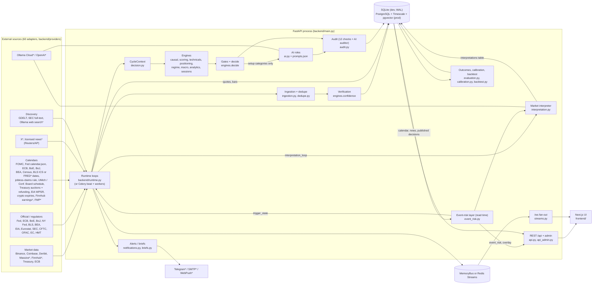
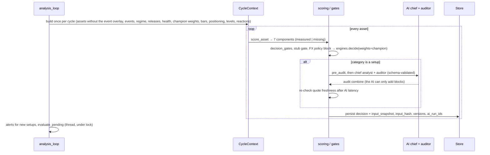
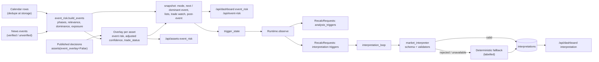

# Architecture

Market Intelligence & Decision Hub is a FastAPI backend with a Next.js 16 UI. Deterministic engines make every decision. AI roles only extract, check and explain, and their output is schema-validated and audited. Nothing places trades.

## System diagram

Nothing the event-risk layer computes reaches `CycleContext` (see "Event layer" below).

`*` marks sources that need a credential. Without one the adapter reports `NOT CONFIGURED`, or with `PROVIDER_MODE=stub` it serves a labelled development stub. See [DATA_SOURCES.md](DATA_SOURCES.md).

## Decision cycle

The analysis runs on the regular cadence in `config/rules.d/refresh.json`. `refresh.detect_triggers` can also request an immediate run, debounced by `RecalcRequests` (at least `triggers.min_interval_seconds` apart). The triggers are:

- a new breaking or central-bank event (backfilled STALE events excluded);
- a change in fact status;
- a macro release;
- a large move;
- a clear level break (same margin as level-break alerts);
- a cross-asset divergence (including a post-event MARKET DIVERGENCE);
- a market opening or closing.

Event-window, release, press-conference, regime and score-change triggers refresh only the market interpretation (`refresh.interpretation.triggers`), never the decisions. See [DECISION_ENGINE.md](DECISION_ENGINE.md) section 9.

## Event layer

The event layer answers "what can move the market next" beside the decisions. It is deterministic except for one AI role that only explains. The contract is [EVENT_AWARENESS.md](EVENT_AWARENESS.md).

- `backend/event_risk.py` builds EventObjects from calendar rows and news events, then the snapshot and the per-asset overlay. It reads published assets without the overlay, news, calendar rows, the regime, ticks (post-event reactions) and stored interpretation runs. Its only write is the post-event impact history (`record_history`, after each analysis cycle). Config: `rules.d/event_risk.json`, `rules.d/event_exposure.json`.
- `backend/interpretation.py` runs the `market_interpreter` role on a compact, screened bundle of the snapshot. The output has a strict schema (`MarketInterpretationOutput` in `schemas.py`) and passes validators for event ids, asset lists, numbers in context, clock times, surprise assessments with official evidence, trade statuses, unverified events and plain language. A rejected output is retried once per model, primary then backup. Without a valid output a deterministic summary of the same snapshot is stored, labelled "Deterministic summary — AI unavailable". Each run is stored as a row of the `interpretations` table (migration `0005`); a run whose inputs (`basis_hash`) are unchanged within `refresh.interpretation.active_seconds` (1800 s) is skipped. The dashboard shows the newest row.
- `Runtime.interpretation_loop` runs it every 1800 s while a traditional market is open (3600 s otherwise) and on its triggers (at most one run per 600 s). Every AI chat request passes the daily AI budget first (`backend/ai_budget.py`, [AI_AGENTS.md](AI_AGENTS.md#daily-ai-budget-backendai_budgetpy)). `Runtime.observe` rebuilds `event_risk.trigger_state` at most every 15 s and feeds both the analysis and the interpretation request queues. The interpretation runs in the API process only (no Celery task).
- `/api/dashboard` carries `event_risk` (or `null` plus `event_risk_error` when the layer fails) and `interpretation`. `/api/event-risk` returns the same `event_risk` block; `/api/events/upcoming` lists every unresolved scheduled event, including those hidden below relevance 40.
- `/api/dashboard` also carries `last_analysis` (the last successful full analysis cycle only) and `analysis` `{last_success_at, last_attempt_at, last_error_type, cadence_seconds, stale, failed_symbols}` from the cycle status each run records (see DECISION_ENGINE.md §6). `failed_symbols` (optional extension of C1) lists the assets the last cycle could not recalculate; they keep their previous decision. The dashboard carries the newest `ui.dashboard_alerts` (30) alerts and `alerts_total`, the number stored.
- Lists: `/api/events?limit=1..500` is cut and ordered on the same key, the event's publication time `event_time` (the published_at of the document that created it; newest first, first seen breaks ties), so neither a backfill nor an older document added to an event later moves an event across the cut; `/api/alerts?limit=1..500`.
- Alerts: `/api/alerts` and the dashboard `alerts` pass every stored row through one read-time presenter (`notifications.readable_alerts`); stored rows are never rewritten. PROVIDER alerts stored before provider alerts carried labels (no `metrics.label`) are shown with the provider's label, its plain status and a plain cause (`HTTPStatusError: HTTP 429` -> `Rate limited (HTTP 429)`, `Status RATE_LIMITED -> ONLINE` -> `Back online (was rate limited)`), and `metrics.label` is set. Every PROVIDER failure alert also carries `resolved` (a later recovery alert of the same provider is in the list, or the provider is ONLINE now) and `resolved_at` (that recovery's time, or null).
- Sources: `/api/sources` rows carry `homepage` (a working https URL from `config/rules.d/sources.json`, null when none is known; the registry `domain` is only the ingestion host suffix) and the `status` / `last_success` of the provider that delivers the source (the source's `provider` in config, e.g. benzinga -> alpaca, ofac -> ofac_actions, x-* -> x, else its own id; null when no running provider delivers it).
- `/api/calendar` rows with `time_known: false` carry `date_window` `{start_utc, end_utc, label, zone}`, the release window the event layer uses (`event_risk.date_window`: the class window, else the row's session such as "after the US close", else the publisher's local day).
- `/api/assets/{symbol}` adds `daily_bars` (up to 260 completed sessions keyed `YYYY-MM-DD`: stored daily OHLC bars, else official daily closes with only `close`, else for a 24/7 asset the last hourly close of each completed UTC day from the stored hourly bars, also close only), `daily_bars_basis` (e.g. "Daily closes from hourly bars: Binance (crypto spot)"), and `cross_asset_interval` (60 or 86400 per overlay). An overlay whose latest quote is a daily close (DXY, yields, indices from FRED), or that has fewer than 2 live one-minute bars, is sent as its daily closes (86400) and is compared with the subject's `daily_bars`. Minute bars (`bars` and 60 s overlays) are built from live ticks only and carry one `time` field; the technical levels keep reading every stored tick, as the decision cycle does. `coverage` separates `level_providers` from `proxy_providers` and lists every source with its configuration state and provider health. Each `session` carries `venue` (machine id) and `venue_label` (plain text, config `market_sessions.venues.*.label`).
- `POST /api/admin/documents` keeps an import that succeeded when the analysis that follows fails: it answers the imported event with a plain `analysis_error`, and the failure is recorded in the analysis status.
- `/api/fx` gives each pair's banks their next rate decision (`next_meetings`, rows with `is_decision`; speeches, testimony and minutes never count) and the soonest as `next_meeting`; a bank without a decision calendar source says so. Rates carry their basis (`fed_rate_range`, `fed_rate_basis`, `other_bank_name`, `other_rate_basis`).
- Transport: HTTP responses of at least 1000 bytes are gzip-compressed when accepted (`ui.http_compression`). The WebSocket fan-out builds the dashboard snapshot at most every `refresh.cadences.ui_snapshot` seconds (5) while clients are connected and computes two fingerprints: one of the per-asset live parts (`assets[].quote`, `assets[].proxy`, per symbol) and one of everything else. When anything else changed, the full `{"type": "snapshot"}` frame is pushed, at most every `refresh.cadences.ui_snapshot_full` seconds (30; a change seen earlier goes out when that interval allows). When only live parts changed, an `{"type": "asset_quotes", "data": {"as_of", "quotes": {SYMBOL: quote|null}, "proxies": {SYMBOL: proxy|null}}}` frame carries just the symbols whose part changed, in the snapshot's own shapes; the client merges it into its cached dashboard. Both fingerprints ignore fields restamped on every build (`as_of`, `generated_at`, `age_seconds` and the countdowns) and on every provider poll (a health row's `latency_ms`, `last_success`, the rate-limit counters `x_ratelimit_reset`, `x_ratelimit_remaining`, `used_weight_*` and `news_lag_seconds`), and compare decaying fact confidence at its displayed precision; those fields stay in the payload that is sent. A client that connects in between gets the latest full snapshot at once.
- New calendar sources: `providers/econ_calendars.py` (Fed calendar.json, BEA, Census, BLS ICS, jobless-claims rule, UMich / Conference Board schedule, Treasury refunding and tentative auctions), Finnhub earnings (`providers/finnhub.py`) and FRED release dates as the BLS fallback (`providers/official_data.py`). The calendar hygiene (replacement, dedupe with value lending) lives in `providers/calendars.py`.

## Backend modules

| Area | Modules | Responsibility |
|---|---|---|
| Entry | `main.py` (root launcher), `backend/main.py` | Launcher re-execs into `.venv`, runs uvicorn (selector loop on Windows), starts the UI. `create_app` wires store, hub, bus, runtime and fan-out. |
| Config | `config.py`, `config/rules.json` + `config/rules.d/*.json`, `config/prompts.json` | Settings from env. Merged rules with a content hash (fragments may not redefine keys). Cached; re-stat at most once per second. `rules()` returns a private copy per call; per-row and per-tick code reads `rules_view()` (also `sessions.ruleset()`), one shared, deeply read-only view (`FrozenDict` / `FrozenList`) where a write raises `TypeError`. Event-layer fragments: `event_risk.json` (phases, scores, overlay, post-event), `event_exposure.json` (taxonomy, exposure, regime effects, scenarios) and `ai_runtime.json` (per-role LLM timeout and attempts). |
| Storage | `database.py`, `migrations/` | Typed core tables plus JSON record tables, batched `put_many`, SQLite WAL. See [DATABASE.md](DATABASE.md). |
| Providers | `providers/*` | Runtime-checkable protocols, `build_providers` registry, strict payload validation (`providers/models.py`), health and metrics per adapter, stubs. |
| Ingestion | `ingestion.py`, `dedupe.py`, `security.py` | UTC normalisation, source-domain check, canonical-URL and similarity dedupe, syndication detection, prompt-injection flags, evidence with trust overrides. |
| Engines | `engines.py`, `scoring.py`, `causal.py`, `technicals.py`, `positioning.py`, `regime.py`, `macro.py`, `analytics.py`, `sessions.py` | Verification confidence, score components, causal graph, levels and ATR, options and futures positioning, regime drivers, macro surprise z-scores, reaction baskets, market sessions. |
| Decision | `decision.py`, `audit.py` | Per-cycle context, gates, AI chief and auditor for setups, reproducible audit records (§52). |
| Event layer | `event_risk.py`, `interpretation.py`, `providers/econ_calendars.py`, `providers/calendars.py` | Deterministic EventObjects, relevance, dominance, EVENT RISK MODE, per-asset overlay (event risk, adjusted confidence, trade status), post-event reactions; the `market_interpreter` role with strict schema, validators, labelled deterministic fallback and the `interpretations` table; official release calendars and calendar hygiene. |
| AI | `ai.py` | Provider abstraction (Ollama, optional OpenAI), model discovery, role assignment with fallback, `ai_runs` log, search budget P0–P3. See [AI_AGENTS.md](AI_AGENTS.md). |
| Services | `service.py` (`HubService`), `runtime.py`, `workers.py`, `refresh.py` | Read models for the API (quotes with freshness, assets with the event overlay, event detail, calendar, regime, dashboard with `event_risk` and `interpretation`). Polling and adaptive loops in-process, or the same jobs under Celery. `Runtime.observe` samples trigger state (including `event_risk.trigger_state`); `Runtime.interpretation_loop` refreshes the market interpretation (in-process only). |
| Output | `api.py`, `api_admin.py`, `streams.py`, `notifications.py`, `briefs.py`, `telemetry.py`, `metrics.py` | Public read API (including `/api/event-risk` and `/api/events/upcoming`), audited admin API, WebSocket fan-out, alert dispatch (in-app, Telegram, SMTP, WebPush), morning/intraday briefs, structured JSON logs, provider metrics. |
| Learning | `evaluation.py`, `calibration.py`, `backtest.py` | Outcomes without lookahead, performance breakdowns, champion/challenger shadow calibration, backtests. See [AUTOLEARN.md](AUTOLEARN.md). |

## Frontend

The UI is Next.js App Router (`frontend/app`) with React 19, Tailwind 4, shadcn/ui and TanStack Query.

- **Routes:** `/` (dashboard), `/assets/[symbol]`, `/events/[id]`, and `/[section]` for events, calendar, fx, sources, providers, alerts, social, performance and settings.
- **Components:** grouped under `components/{ui,shared,dashboard,asset,event,pages}`.
- **API access:** the browser only calls the backend at `NEXT_PUBLIC_API_URL`. No secret reaches browser code.
- **Live data:** quotes arrive over `/ws` with a polling fallback, and the browser expires cached prices on its own when the socket drops.
- **Opening dashboard:** the market view and its reasons, current uncertainty, the next market-moving event,
  favored/pressured/not-confirming assets and at most five trade-watch cards are the primary reading path.
  Longer scenarios, calendar context, reactions, news, providers and all markets remain available in collapsed
  sections. This is a presentation change using the existing read models; it adds no market signal or feature.
- **Guidance continuity:** asset details merge the dashboard's latest published decision and event overlay
  immediately, including same-id read-time blocks. A failed detail reload preserves charts and cannot restore
  an older actionable signal. Interpretations carry their configured stale deadline so the browser can mark a
  cached summary stale even when updates stop.
- **Display:** all times are shown in Europe/Bucharest (IANA), all storage is UTC.
- **Event awareness:** the dashboard reads the `event_risk`, `event_risk_error` and `interpretation` blocks of `/api/dashboard`. Without `event_risk` it renders as before; with `event_risk_error` it shows a quiet notice and the rest renders.
  - `components/dashboard`: `event-risk-banner.tsx` (EVENT RISK MODE), `next-event-card.tsx` (next and dominant event), `market-view.tsx` (favored / under pressure / not confirming, what can break this view), `ai-interpretation.tsx` (summary and per-event scenarios, or the labelled deterministic summary), `trade-watch.tsx`, `post-event-panel.tsx` (reactions, MARKET DIVERGENCE), `active-events.tsx` (active event risk and unverified reports), and the AI VIEW line in `regime-banner.tsx`. `components/asset/asset-event-risk.tsx` shows the overlay on the asset page.
  - `lib/event-risk.ts` presents the block and shows missing data literally ("NO CONSENSUS", "UNKNOWN", "EVENT DATA INCOMPLETE"). `lib/event-time.ts` computes countdowns from `time_utc` on the client (a one-second clock). `lib/trade-watch.ts` may only downgrade a backend trade status when the browser's own freshness gates fail, never upgrade it.

## Deployment modes

| Mode | Processes | Scheduling | Bus |
|---|---|---|---|
| Local (`python main.py`) | one uvicorn process + `next dev` | in-process `Runtime` loops | in-memory |
| Docker Compose | db (Timescale/pgvector), redis, migrate, api, worker, beat, web | Celery beat from `refresh.json` (`celery_owned` loops are skipped in the API) | Redis Streams |

## Invariants the code enforces

- Market prices come only from market-data providers. Search and discovery results never become prices or confirmations.
- Delayed or daily-close data is labelled (`STALE`, `FRIDAY CLOSE`, `daily_close`), and a stale quote downgrades any setup to WAIT at read time.
- A missing decision score component adds nothing, and its weight is not redistributed (event relevance, a display score, renormalises instead).
- The AI never computes numbers, sets weights or promotes configurations.
- Every published decision stores its configuration version (content hash), input snapshot and input hash.
- The event overlay never feeds decisions. `CycleContext` reads `hub.assets(event_overlay=False)`; the overlay adds `event_risk` beside a published decision at read time and never changes its category, score or blocks.
- Missing expectations are never invented: without a consensus the event shows `NO CONSENSUS`, without market pricing `UNKNOWN`. The interpreter receives them as such, and its number checks reject any value absent from its input.
- Unverified (X or social) events are isolated and labelled `POTENTIAL EVENT · UNCONFIRMED`. They never reach event risk, dominance or trade statuses, and the interpreter sees them only as unverified reports that any sentence naming them must call unverified.
