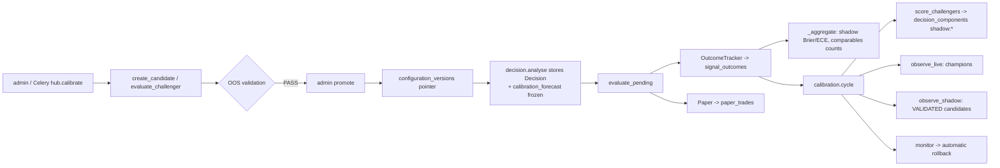
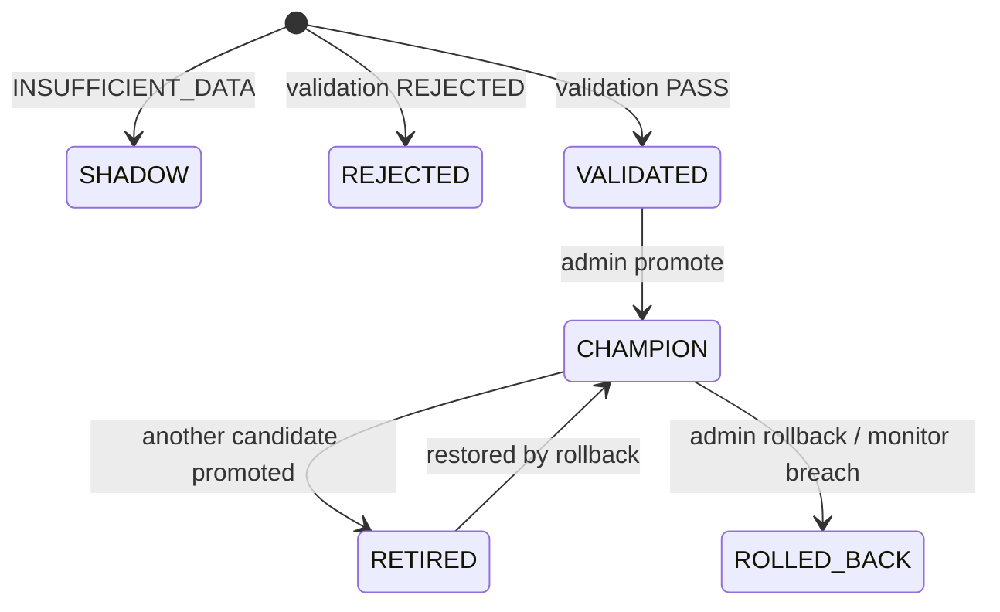

# Autolearn

Sources of truth: `backend/evaluation.py` (outcomes and paper trades), `backend/calibration.py` (calibration, challengers, promotion, rollback), `backend/backtest.py` (point-in-time replay), `backend/api_admin.py` and `backend/api.py` (endpoints), `backend/workers.py` (scheduling), `config/rules.d/autolearn.json` (`autolearn_version` 1.0.0), and `config/rules.json` (`thresholds`, `weights`).

## Hard rules

- Decisions are stored first and measured later, only from data that was ingested by the horizon end. There is no lookahead.
- Every decision is measured. WAIT and lean decisions are scored as flagged **counterfactuals** on the sign of the score.
- Too few observations never produce a directional probability. The answer is `NOT ENOUGH DATA`.
- Candidates and challengers run in shadow and are never published. **Promotion is admin-only.** Rollback is either an admin action or the deterministic monitor. Every transition is audited.
- **No LLM changes production weights.** Weights come from `rules.json` (admin config edit) or a promoted, validated weights champion. AI roles have no endpoint, tool or config path to either (see [AI_AGENTS.md](AI_AGENTS.md)). The backtest does not replay the AI.

## Pipeline

Scheduling:

- In-process runtime: `evaluate_pending` runs after every analysis cycle (`interpretation`: 300 s, or 900 s when inactive), under `analysis_lock`.
- Celery beat (when Celery and Redis are enabled): `hub.evaluate_outcomes` every 60 s. `hub.calibrate` every 86400 s creates one calibration candidate per asset at the default 4h horizon, then runs `monitor`.

## Outcome horizons

| Label | End of horizon | Source |
|---|---|---|
| `5m` | decision time + 300 s | `autolearn.horizons` |
| `15m` | + 900 s | same |
| `1h` | + 3600 s | same |
| `4h` | + 14400 s | same; `report_horizon` is `4h` |
| `close` | Close of the session containing the decision time, or the next session's close if between sessions | `sessions.session_close`, `market_sessions` venues |
| `next_session` | Close of the following session | `sessions.next_session_close` |

Venue rules (`autolearn.json` → `market_sessions`):

| Venue | Rule |
|---|---|
| Crypto | 00:00 UTC cut-off |
| FX | 17:00 New York roll |
| Equities | XNYS calendar |
| Index | XNYS regular session |
| Treasuries | us_futures calendar with the 16:00–17:00 Chicago maintenance break |
| CME commodities | CMES calendar with the 16:00–17:00 Chicago maintenance break |
| DXY, BRENT | ICE (IEPA) |
| VIX | XCBF |

## No-lookahead rules (`evaluation.py`)

| Rule | Implementation |
|---|---|
| Decision time is the latest point at which the decision was known | `decision_time` = max(`created_at`, `decided_at`, input quote `timestamp`) |
| A tick is usable only if it was ingested by the boundary | `_usable`: `ingested_at ≤ boundary`, `timestamp ≤ ingested_at`, `price > 0`, provider not `*-stub` |
| The entry tick is fresh | Latest usable tick at or before the decision time, no older than `QUOTE_STALE_SECONDS` (default 15) |
| The path is fresh at the end | The last tick in the window must be within `QUOTE_STALE_SECONDS` of the horizon end, otherwise the outcome is unmeasurable (`unavailable`) |
| No outcome before the horizon closes | Outcomes are skipped while `horizon_end > now`. `decision_settle_seconds` is 0. |
| Forecasts count only if frozen beforehand | `_forecast`: `trained_through < generated_at ≤ decision_at`. A score is never read as a probability. |
| Calibration is trained only on labels known before validation | `purged_split`: chronological 70/30 split; training rows whose horizon end is at or after the first validation timestamp are dropped |
| A champion is used only after its training cutoff | `historical_probability` and `calibration_forecast` require `trained_through < now` |

Evaluation is incremental. There is one cursor per `symbol|horizon` in `configuration_versions/autolearn:evaluation-cursor`, and at most `max_decisions_per_cycle` = **2000** decisions are processed per cycle. Extrema are tick-sampled: `sampling` = "observed ticks ingested by the horizon end; extrema may miss between-tick moves".

## Outcome record (`signal_outcomes`, id `{decision_id}:{horizon}`)

- **Prices and returns:** `entry_price`, `end_price`, `raw_return_pct`, `raw_high_pct`, `raw_low_pct`, and `return_pct` (signed by side).
- **Excursions:** `mfe_pct` = max(0, favourable) and `mae_pct` = min(0, adverse), both from the high/low of the window.
- **Levels:** `confirmation_level`, `invalidation_level`, `*_occurred`, `*_at`, and `first_trigger` (`CONFIRMATION`, `INVALIDATION` or `BOTH_SAME_TICK`).
- **Signal:** `side`, `actionable` (a setup band from the `rules.json` category table), `counterfactual`, `score`, `category`.
- **Context:** `regime_key`, `groups` (see [Reports](#reports)), `forecast_probability`, `forecast_model_id`.
- **Versions:** `rules_version`, `autolearn_version`.

## Paper execution and costs (`paper_trades`)

Paper trades are opened only for **actionable decisions with `audit_status` = PASS**. At most one open trade is allowed per symbol, and no new trade opens if the last close came after the decision.

| Item | Rule / config |
|---|---|
| Entry | Observed ask for a long, bid for a short, plus `slippage_bps` **5**. Requires a valid, fresh bid/ask with spread ≤ `max_spread_bps` **50** (`rules.json`). |
| Stop | `invalidation_level`, else the opposite support/resistance level, else none |
| Target | The next level if still ahead of the fill, else **2.0 × ATR**, else **2.0 R** |
| Exit | First of STOP, TARGET or TIME (`expiry_horizon` **4h**), at the executable side minus slippage |
| Fees | `fee_bps` per class, charged on entry and exit: crypto **10**, equity **1**, index **1**, fx **0**, default **0** |
| Sizing | `equal_notional`: notional **10000** on **100000** initial virtual equity. `fixed_risk` is optional: `risk_pct` 0.5, `max_notional_pct` 25. |
| Tracking | `mfe_pct`/`mae_pct` at the executable price. At most `max_ticks_per_cycle` = **200000** ticks per cycle. |

## Reports

`GET /api/performance?group_by=&population=all|actionable|counterfactual&horizon=` returns per-horizon `summarize()` output, paper metrics, and breakdowns at the report horizon (default `4h`).

- **Outcome metrics:**
  - observations (actionable and counterfactual)
  - hit rate
  - mean and median return, MFE and MAE
  - Brier score and calibration error (10 bins)
  - false-positive rate: actionable signals only, where the return was ≤ 0 or `INVALIDATION` came first
  - counterfactual failure rate
  - confirmation and invalidation rates
  - max drawdown
- **Paper metrics:** closed/open trades, hit rate, mean/median return, profit factor, drawdown (points and equity %), MFE/MAE, total P&L, equity. All are net of fees and slippage.
- **Breakdown dimensions:** `asset`, `event_type`, `regime`, `score_bucket` (lean 15 / setup 30 / strong 60), `confidence_bucket` (edges 25/50/75/90), `source_combination`, `setup`.
- **Status:** always `probability: null`, with status `UNCALIBRATED`, or `INSUFFICIENT_DATA` when there are no outcomes.

`GET /api/assets/{symbol}/comparables` returns past decisions with their outcomes per horizon.

## Minimum samples

| Threshold | Value | Used for |
|---|---|---|
| `thresholds.minimum_calibration` | **200** | Training rows needed to fit a candidate; validation rows needed for PASS; the pre-audit `probabilities_valid` check (`n ≥ 200`); shadow `minimum_met` |
| `autolearn.min_comparable` | **30** | Comparable decisions (same symbol, horizon and score bucket, in the same regime posture or else `*`) needed before `historical_probability` returns a `p` |
| `calibration.min_regime_observations` / `min_regimes` | **30** / **2** | Regime robustness: at least 2 regimes with at least 30 validation rows each, with no negative mean improvement in any of them |
| `rollback.min_observations` | **100** | Live observations before the monitor may roll a champion back |

`historical_probability` returns `NOT ENOUGH DATA` in three cases:

- No champion has been promoted for the symbol and horizon.
- The champion's `trained_through` is not before now.
- There are fewer than 30 comparables.

Otherwise it returns `p`, `n`, the calibration quality (`good` ≤ 0.05, `fair` ≤ 0.10, otherwise `poor`), the Brier score and `trained_through`.

## Calibration candidates (per symbol × horizon)

- **Model:** logistic `P(up) = σ(w·score/100 + b)`, where the target is `raw_return_pct > 0`. Gradient descent runs for `iterations` **400** with `learning_rate` **0.1** and `l2` **0.01**.
- **Creation:** `create_candidate`. Training data is the purged 70/30 split (`train_fraction` **0.7**). The candidate is validated against the active champion, or against the training base rate when there is none.
- **Result:** the candidate is stored in `calibration_models` with `data_ids`, `trained_through`, `validation_from`, `rules_version`, `content_hash` and `autolearn_version`.

## Challengers (shadow weight sets)

The challengers are configured in `autolearn.challengers`. The champion is `rules.json` `weights` until a weights candidate is promoted.

| Component | rules.json (champion) | `reaction-weighted` | `catalyst-weighted` |
|---|---|---|---|
| event | 0.30 | 0.25 | 0.38 |
| macro | 0.20 | 0.15 | 0.24 |
| reaction | 0.15 | 0.22 | 0.12 |
| technical | 0.15 | 0.20 | 0.10 |
| positioning | 0.08 | 0.07 | 0.06 |
| cross_asset | 0.07 | 0.06 | 0.05 |
| regime | 0.05 | 0.05 | 0.05 |

- **Shadow scoring:** `score_challengers` re-scores every new decision from its unweighted measured components. The result is stored as `decision_components/shadow:{challenger}:{decision}` with `published: false`.
  - Missing components contribute 0 and are listed in `components_missing`.
  - Data and session gates carry over from the original decision.
  - A setup downgrade is re-derived from the challenger's score.
- **Evaluation:** `evaluate_challenger` runs a paired test. The challenger and the champion must both have a score for the same decision. Each score is calibrated on the training window and compared out of sample.

## Out-of-sample validation gate (`calibration.compare`)

A candidate gets `PASS` only if **all** of the following hold. The configuration values come from `autolearn.calibration`.

| Check | Condition |
|---|---|
| Sample | validation rows ≥ `minimum_calibration` (200) |
| Brier improvement | Lower 95% bound of the paired Brier improvement > 0 (`confidence_z` 1.96) |
| Calibration | ECE ≤ `max_calibration_error` **0.10**. When the champion is a model, ECE must also be ≤ the champion's ECE + `calibration_error_tolerance` **0.05**. |
| False positives | Call FPR ≤ champion FPR + `fpr_tolerance` **0.0**. Calls are p ≥ `call_up` **0.6** or p ≤ `call_down` **0.4**, net of `cost_bps` **10**. If the champion makes no calls, the benchmark is the live score-sign signals. |
| Regime robustness | See [Minimum samples](#minimum-samples) |
| Risk | The candidate makes at least 1 call, and its drawdown ≤ the champion's drawdown × (1 + `drawdown_tolerance` **0.0**) |

The result records `limitations: "overlapping horizons make observations dependent"`.

## Lifecycle, promotion and rollback

**Promotion.** `POST /api/admin/calibration/promote/{candidate_id}` handles both calibration and weights candidates.

- Promotion requires validation `PASS`, a state of `VALIDATED`, and an unchanged champion since validation. If the champion changed, the call fails with "Champion changed since validation; create a new candidate".
- Promotion writes a pointer in `configuration_versions`: `calibration:{symbol}:{horizon}` or `weights:champion`. The pointer nests the previous pointer so it can be rolled back.
- The previous champion becomes `RETIRED`.
- Audit entries: `calibration_promote` (API) and `{kind}_promotion`.
- `rules.json` is never edited. A promoted weights champion is read by `champion_weights()` at the start of each analysis cycle. Decisions record `versions.weights` = `autolearn` and `versions.weights_candidate`.
- VALIDATED candidates keep a forward `shadow_live` record (`observe_shadow`). `promote()` does not require it.

**Manual rollback.**

- Calibration: `POST /api/admin/calibration/{symbol}/rollback?horizon=`
- Weights: `POST /api/admin/autolearn/weights/rollback?horizon=`

Rollback restores the nested previous pointer: the previous champion, or `rules.json` weights / the base rate. Audit entries: `calibration_rollback` or `weights_rollback`, plus `{kind}_rollback`.

**Automatic rollback.** `monitor` runs each evaluation cycle and in `hub.calibrate`. Once a champion has ≥ **100** live observations, it rolls the champion back if any of these holds:

- live Brier > validation Brier + **0.02**
- live FPR > validation FPR + **0.05**
- live hit rate < validation hit rate − **0.05**

The rollback is recorded with `reason: automatic`, the metrics and the breaches, and is audited.

State and history: `GET /api/autolearn/versions` (also inside `GET /api/settings` → `autolearn.versions`) returns the active pointers, every candidate with its `transitions`, the challengers and the current champion weights.

## Backtest: point-in-time replay (`backtest.py`)

`POST /api/admin/backtest` takes `{start, end, step_seconds (≥60, default 300), symbols?, weights?, horizons?}`. The window must end by now and has at most `max_steps` = **5000** steps. The call writes a `backtest` audit entry, and the replay itself writes nothing else.

| Input | Visible at simulated time T only if |
|---|---|
| Ticks | `ingested_at ≤ T` (same `_usable` filter as evaluation). Bars come from the previous **48 h** and at most **10000** ticks. |
| Events | `created_at ≤ T` (at most **100**) |
| Evidence | The document and its event link were both created by T, so a later backdated article cannot count |
| Calendar actuals | The row was ingested by T and `actual_ingested_at ≤ T`. Otherwise the actual is masked (`NOT YET KNOWN` / `UNKNOWN INGESTION TIME`). |
| Central-bank state (FX) | `created_at ≤ T` |
| Reaction | Quote ≥ event + **60 s**, baseline tick within the stale window, tolerance **0.05 %** |

The replay rebuilds only the event, technical (±**100**) and reaction (±**100**) components and the deterministic gates. Outcomes are measured with `evaluation.measure` for horizons that have closed by now. `backtest.compare_weights` (champion vs one challenger over the same inputs) exists but has no endpoint yet.

The response lists these `limitations`:

- The AI roles are not replayed.
- Event type and asset tags are the latest stored values.
- The source registry and weights are the current configuration.

## Endpoints

| Method and path | Auth | Purpose |
|---|---|---|
| `GET /api/performance` | public | Outcome and paper metrics, breakdowns |
| `GET /api/assets/{symbol}/comparables?side=&limit=` | public | Past decisions and their outcomes |
| `GET /api/autolearn/versions` | public | Champions, candidates, transitions, challengers |
| `POST /api/admin/calibration/{symbol}/candidate?horizon=4h` | admin | Fit and validate a calibration candidate (shadow) |
| `POST /api/admin/autolearn/challengers/{id}/evaluate?horizon=` | admin | Paired OOS test of a weights challenger (shadow) |
| `POST /api/admin/calibration/promote/{candidate_id}` | admin | Promote a validated candidate (calibration or weights) |
| `POST /api/admin/calibration/{symbol}/rollback?horizon=` | admin | Roll back a calibration champion |
| `POST /api/admin/autolearn/weights/rollback?horizon=` | admin | Roll back the weights champion |
| `POST /api/admin/backtest` | admin | Point-in-time replay |

Admin routes need `X-Admin-Token` = `ADMIN_TOKEN`. **Settings → Autolearn** exposes calibration candidate creation, promotion by ID and calibration rollback. Challenger evaluation, weights rollback and backtest are API-only.

## Known gaps (as of this code)

- Session horizons (`close`, `next_session`) use the longest fixed horizon (14400 s) as the purge fallback when an
  outcome has no `horizon_end`.
- `backtest.compare_weights` has no endpoint.

Resolved:
- A published probability is attached before the pre-audit. It requires `n >= min_comparable` and a champion
  validated on `>= minimum_calibration` observations.
- Daily calibration candidates and the rollback monitor also run in-process (`Runtime.calibrate`, once per
  `refresh.calibration` cadence, persisted across restarts) when Celery is off.
