# Database

The schema lives in `backend/database.py` (SQLAlchemy 2). One `Store` object works against any SQLAlchemy URL taken from `DATABASE_URL`. There are 45 application tables plus Alembic's `alembic_version`:

- **7 typed tables** have explicit columns and constraints: `assets`, `market_ticks`, `ohlc_bars`, `raw_documents`, `events`, `event_evidence`, `decisions`.
- **38 JSON record tables** (`RECORD_TABLES`) all share the `RecordMixin` shape:
  - `id varchar(128) PK`
  - `created_at` (UTC, indexed)
  - `payload JSON`

  Each class is generated from its table name.

## Record-table access (`Store`)

| Method | Behaviour |
|---|---|
| `put(table, key, payload)` | Upserts one row in its own transaction. |
| `put_many(table, {key: payload})` | Batch upsert in **one** transaction: selects the existing ids, updates their payloads and inserts the rest. Used for batches from providers and from analysis: `sources`, `provider_health`, `derivative_metrics`, `positioning_reports`, `official_series`, `central_bank_state`, `discovery_items`, `macro_calendar`, `event_relationships`. |
| `get(table, key)` | Returns the payload, or `None`. |
| `list(table, limit=500)` | Returns payloads plus `id`, newest `created_at` first. |

- An upsert replaces the whole payload. `created_at` keeps the time of the first insert, and record tables have no `updated_at`.
- There are no JSON indexes. Filtering on payload fields happens in Python after `list` or a primary-key lookup, or through id-prefix queries (for example `reaction:{event_id}:`).
- Several record tables also hold singleton state rows: cursors, budget state and champion pointers (see the key column in the table catalogue).

## Timestamps

- `UTCDateTime` (`TypeDecorator` over `DateTime(timezone=True)`) converts every bound value to UTC and returns every loaded value as an aware UTC datetime. A naive value is treated as UTC.
  - On PostgreSQL the column type is `timestamptz`.
  - SQLite drops the offset, which is why the conversion is applied on the way in.
- `utcnow()` (`datetime.now(UTC)`) is the default for `created_at`, `updated_at` and `ingested_at`.
- Source time and arrival time are kept apart so that replays never look ahead:
  - `market_ticks.timestamp` (provider time) vs `ingested_at` (arrival);
  - `raw_documents.published_at` vs `created_at` (ingestion).
- Timestamps inside JSON payloads are ISO-8601 strings produced from aware UTC datetimes. The database does not type-check them.

## ER diagram

Legend:

- **Solid line**: SQL `FOREIGN KEY`.
- **Dotted line**: logical reference held in a column, a key format or a JSON payload. It is not enforced by the database.
- Typed tables show all columns. Record tables show only `id` and its key format; they also have `created_at` and `payload`.
- Tables marked `reserved` are created but nothing in `backend/` writes to them.

```mermaid
erDiagram
    %% ===== Market data (typed) =====
    assets {
        varchar(128) id PK "same as symbol"
        varchar(32) symbol UK
        varchar(100) name
        varchar(32) asset_class
        datetime created_at "UTC, indexed"
        json payload
    }
    market_ticks {
        varchar(128) id PK "uuid4"
        datetime timestamp PK "provider time UTC, hypertable key on PG"
        datetime ingested_at "arrival time UTC"
        varchar(32) symbol "indexed, ix (symbol, timestamp)"
        float price
        varchar(64) provider
        json payload "validated Quote"
    }
    ohlc_bars {
        varchar(32) symbol PK
        int interval_seconds PK "1 5 60 300 3600"
        datetime start PK "UTC, hypertable key on PG"
        float open
        float high
        float low
        float close
        float volume
        int ticks
        varchar(64) provider
    }
    %% ===== Events and evidence (typed) =====
    raw_documents {
        varchar(128) id PK "uuid4"
        varchar(64) fingerprint UK "sha256 of provenance, source, url, title, content"
        varchar(128) source_id "indexed"
        datetime published_at "indexed"
        text title
        text url "canonical"
        text content
        datetime created_at "ingestion time"
        json payload "provenance, discovery_only, dedupe, injection flags"
    }
    events {
        varchar(128) id PK "uuid4"
        text summary_fact
        varchar(64) event_type
        varchar(32) verification_status "default UNCONFIRMED"
        float fact_confidence
        datetime updated_at
        datetime created_at "indexed"
        json payload "assets, topic, trigger, novelty, injection flags"
    }
    event_evidence {
        varchar(128) id PK "uuid4"
        varchar(128) event_id FK "indexed"
        varchar(128) document_id FK, UK
        varchar(32) relation "supports or contradicts"
        datetime created_at
        json payload
    }
    %% ===== Decisions (typed) =====
    decisions {
        varchar(128) id PK "uuid4"
        varchar(32) symbol "indexed"
        varchar(32) direction
        float score
        datetime created_at "indexed"
        json payload "versions, input_hash, input_snapshot, ai_run_ids, audit"
    }

    %% ===== Market data and analytics (record) =====
    derivative_metrics {
        varchar(128) id PK "instrument_name"
    }
    central_bank_state {
        varchar(128) id PK "bank id"
    }
    macro_calendar {
        varchar(128) id PK "calendar item id"
    }
    macro_releases {
        varchar(128) id PK "sha256 indicator and scheduled_at"
    }
    market_regimes {
        varchar(128) id PK "uuid4"
    }
    asset_scores {
        varchar(128) id PK "latest-cycle or last-update"
    }
    market_bars {
        varchar(128) id PK "reserved"
    }
    technical_levels {
        varchar(128) id PK "reserved"
    }
    %% ===== Events, evidence, sources (record) =====
    sources {
        varchar(128) id PK "source id from sources.json"
    }
    source_reliability {
        varchar(128) id PK "source id"
    }
    social_posts {
        varchar(128) id PK "X post id"
    }
    event_relationships {
        varchar(128) id PK "reaction, basket or reactions-complete prefix"
    }
    research_jobs {
        varchar(128) id PK "uuid4 or search-budget-state"
    }
    causal_rules {
        varchar(128) id PK "reserved"
    }
    %% ===== Decisions and outcomes (record) =====
    signal_outcomes {
        varchar(128) id PK "decision_id and horizon"
    }
    paper_trades {
        varchar(128) id PK "decision id"
    }
    decision_components {
        varchar(128) id PK "shadow, challenger_id, decision_id"
    }
    calibration_models {
        varchar(128) id PK "uuid4 or stats key"
    }
    recalc_triggers {
        varchar(128) id PK "uuid4"
    }
    score_components {
        varchar(128) id PK "reserved"
    }
    shadow_decisions {
        varchar(128) id PK "reserved"
    }
    backtest_runs {
        varchar(128) id PK "reserved"
    }
    %% ===== AI (record) =====
    ai_models {
        varchar(128) id PK "model name"
    }
    ai_role_assignments {
        varchar(128) id PK "role name"
    }
    ai_runs {
        varchar(128) id PK "uuid4"
    }
    %% ===== Configuration, audit, operations (record) =====
    configuration_versions {
        varchar(128) id PK "version and hash16, pointer or cursor"
    }
    audit_logs {
        varchar(128) id PK "uuid4"
    }
    provider_health {
        varchar(128) id PK "provider name"
    }
    briefs {
        varchar(128) id PK "morning date or uuid4"
    }
    providers {
        varchar(128) id PK "reserved"
    }
    provider_metrics {
        varchar(128) id PK "reserved"
    }
    %% ===== Notifications (record) =====
    alerts {
        varchar(128) id PK "kind, symbol, signature, window"
    }
    notification_deliveries {
        varchar(128) id PK "alert_id and channel"
    }
    push_subscriptions {
        varchar(128) id PK "sha256 of endpoint"
    }
    %% ===== Source tables, migration 0003 (record) =====
    credit_spreads {
        varchar(128) id PK "series, e.g. BAA10Y"
    }
    positioning_reports {
        varchar(128) id PK "provider, contract, report, as_of"
    }
    official_series {
        varchar(128) id PK "provider, series, period"
    }
    discovery_items {
        varchar(128) id PK "candidate_id or gdelt-intensity batch"
    }

    %% ----- SQL foreign keys -----
    events ||--o{ event_evidence : "FK event_id"
    raw_documents ||--o| event_evidence : "FK document_id unique"

    %% ----- logical references -----
    assets ||..o{ market_ticks : "symbol"
    assets ||..o{ ohlc_bars : "symbol"
    assets ||..o{ decisions : "symbol"
    sources ||..o{ raw_documents : "source_id"
    sources ||..o| source_reliability : "same id"
    sources ||..o{ macro_calendar : "payload.source_id"
    sources ||..o{ social_posts : "payload.source_id"
    events |o..o{ social_posts : "payload.event_id"
    events ||..o{ event_relationships : "event_id in key"
    events |o..o{ research_jobs : "payload.event_id"
    events }o..o{ decisions : "payload.input_snapshot.events"
    events |o..o{ alerts : "payload.event_id"
    decisions |o..o{ alerts : "payload.decision_id"
    decisions ||..o{ signal_outcomes : "decision_id in key"
    decisions ||..o| paper_trades : "same id"
    decisions ||..o{ decision_components : "decision_id in key"
    decisions }o..o{ calibration_models : "payload.data_ids"
    decisions |o..o{ ai_runs : "payload.ai_run_ids"
    configuration_versions ||..o{ decisions : "payload.versions rules and content_hash"
    calibration_models |o..o{ configuration_versions : "pointer candidate_id"
    ai_models ||..o{ ai_runs : "payload.model"
    ai_models }o..o{ ai_role_assignments : "primary, backup, second_opinion"
    alerts ||..o{ notification_deliveries : "alert_id in key"
```



## Enforced vs logical relationships

- **SQL foreign keys (only two).**
  - `event_evidence.event_id → events.id`
  - `event_evidence.document_id → raw_documents.id`. This column is `UNIQUE`, so a document belongs to at most one event.
  - Neither key has `ON DELETE` rules. The application never deletes events or documents.
- **Enforced on both engines.** `Store` sets `PRAGMA foreign_keys=ON` on every file-SQLite connection, together with WAL and `synchronous=NORMAL`. PostgreSQL enforces them natively.
- **Other constraints:** `assets.symbol` UNIQUE, `raw_documents.fingerprint` UNIQUE, and the composite primary keys on `market_ticks` and `ohlc_bars`.
- **Everything else is logical.** It is carried by a `symbol` or `source_id` column, a key format, or a payload field, and checked in application code:
  - ingestion rejects unknown `source_id` values and unknown symbols;
  - AI output with an unknown evidence id fails closed;
  - `PUT /admin/roles` requires an available model.

## Table catalogue

`T` marks a typed table and `R` a record table. "Reserved" means the table is created but nothing in `backend/` writes to it.

### Market data and analytics

| Table | | Key | Purpose |
|---|---|---|---|
| `assets` | T | symbol | Tracked instruments from `rules.json` `assets`, synchronized at startup. |
| `market_ticks` | T | (id, timestamp) | Validated quotes with provider time and ingestion time. Timescale hypertable on PostgreSQL. Raw ticks are pruned after `raw_tick_retention_hours` (168). |
| `ohlc_bars` | T | (symbol, interval_seconds, start) | 1s/5s/1m/5m/1h OHLC built from live, non-stub ticks. Hypertable on PostgreSQL. Retention per interval: 1 d, 3 d, 30 d, 180 d and 1825 d. |
| `derivative_metrics` | R | instrument_name | Deribit option and futures summaries (open interest, mark price, IV). |
| `central_bank_state` | R | bank id | Policy rate, yields and as-of time per central bank. |
| `macro_calendar` | R | item id | Scheduled releases, from providers and admin imports, with consensus, actual and surprise. |
| `macro_releases` | R | sha256(indicator:scheduled_at) | One row per released print. |
| `market_regimes` | R | uuid | Regime snapshot per analysis cycle. |
| `asset_scores` | R | `latest-cycle`, `last-update` | Current cycle snapshot and the baseline of the last published update, used for intraday briefs. |
| `market_bars` | R | n/a | Reserved. Superseded by `ohlc_bars`. |
| `technical_levels` | R | n/a | Reserved. Levels are computed on read. |

### Events, evidence and sources

| Table | | Key | Purpose |
|---|---|---|---|
| `sources` | R | source id | Source registry (domain, tier, kind, independence group) from `rules.d/sources.json`, re-synchronized at startup. |
| `source_reliability` | R | source id | Admin trust overrides (tier, trust_weight, enabled). Audited. |
| `raw_documents` | T | uuid | Ingested document text, canonical URL, fingerprint and provenance flags. |
| `events` | T | uuid | Deduplicated story. Verification status and confidence are recomputed from the evidence. |
| `event_evidence` | T | uuid | Event-to-document link with `supports` or `contradicts`. |
| `event_relationships` | R | `reaction:{event}:{symbol}:{window}`, `basket:{event}:{window}`, `reactions-complete:{event}` | Measured market reactions after an event and basket confirmation. |
| `social_posts` | R | X post id | X posts with their source and linked event. |
| `research_jobs` | R | uuid, `search-budget-state` | Web-search research results (discovery only) and the search budget and cooldown state. |
| `causal_rules` | R | n/a | Reserved. Causal rules live in configuration. |

### Decisions and outcomes

| Table | | Key | Purpose |
|---|---|---|---|
| `decisions` | T | uuid | Published decision per asset. Payload holds versions, `input_hash`, `input_snapshot`, `ai_run_ids`, audit and levels. |
| `signal_outcomes` | R | `{decision_id}:{horizon}` | Realized outcome of a decision per horizon, used for evaluation and calibration. |
| `paper_trades` | R | decision id | Simulated position (`mode=PAPER`) for audited, actionable decisions. |
| `decision_components` | R | `shadow:{challenger}:{decision}` | Shadow score from a challenger weight set for each decision. |
| `calibration_models` | R | uuid, `shadow-outcomes-v1`, `comparables-v1` | Calibration and weights candidates with their state history, plus statistics rows. |
| `recalc_triggers` | R | uuid | Log of why a recalculation ran. |
| `score_components`, `shadow_decisions`, `backtest_runs` | R | n/a | Reserved. Backtests are returned and audited, not stored. |

### AI

| Table | | Key | Purpose |
|---|---|---|---|
| `ai_models` | R | model name | Registry from provider discovery: capabilities, digest, availability, preferred roles. |
| `ai_role_assignments` | R | role | Primary, backup and second-opinion model per role. |
| `ai_runs` | R | uuid | One row per LLM call: model, prompt version and hash, input hash, injection findings, raw output, validation errors, latency. |

### Configuration, audit and operations

| Table | | Key | Purpose |
|---|---|---|---|
| `configuration_versions` | R | `{version}:{hash16}`, `calibration:{symbol}:{horizon}`, `weights:champion`, `autolearn:*-cursor` | Content-addressed snapshots of the rules, champion pointers and evaluation cursors. |
| `audit_logs` | R | uuid | Admin and automated change log (action, timestamp, before/after, reason). |
| `provider_health` | R | provider name | Last health status of each provider. |
| `briefs` | R | `morning:{date}`, uuid | Morning and intraday briefs. |
| `providers`, `provider_metrics` | R | n/a | Reserved. Health and metrics are held in memory and in `provider_health`. |

### Notifications

| Table | | Key | Purpose |
|---|---|---|---|
| `alerts` | R | `{kind}:{symbol}:{signature}:{window_start}` | In-app alerts. The key deduplicates alerts within a cooldown window. |
| `notification_deliveries` | R | `{alert_id}:{channel}` | Outcome of each alert on each channel (status, attempts, error type). |
| `push_subscriptions` | R | sha256(endpoint) | Web Push subscriptions with an `active` flag. |

### Source tables (migration 0003)

| Table | | Key | Purpose |
|---|---|---|---|
| `credit_spreads` | R | series (`BAA10Y`) | Latest FRED credit spread, daily change in bp, freshness. |
| `positioning_reports` | R | provider:contract:report:…:as_of | CFTC COT and futures funding/OI rows. |
| `official_series` | R | provider:series:period | Official statistics (ECB, Eurostat, BLS, Treasury, EIA, FRED). |
| `discovery_items` | R | candidate_id, `gdelt-intensity:{batch}` | GDELT discovery candidates and intensity snapshots. These are never evidence; OFAC and SEC full-text become `raw_documents` instead. |

## SQLite (development) vs PostgreSQL (production)

| | SQLite | PostgreSQL |
|---|---|---|
| **URL** | `sqlite:///./market_hub.db` (default, relative to the working directory; `main.py` switches to the project root first) | `postgresql+psycopg://market:…@db:5432/market` (docker-compose) |
| **Schema creation** | `Store.initialize()` runs `Base.metadata.create_all` at app startup, so migrations are not required | Alembic (`migrate` service) before `api` and `worker` start. The API also runs `create_all` at startup, which does nothing once the migrations have run. |
| **Connection** | `check_same_thread=False`, `timeout=30`. On each connect (not for `:memory:`): `PRAGMA journal_mode=WAL` (readers are not blocked while ingestion writes) and `PRAGMA synchronous=NORMAL`. The `-wal` and `-shm` files are gitignored. | `pool_pre_ping=True` |
| **Extensions** | none | Image `infra/postgres`: `timescale/timescaledb:latest-pg16` plus pgvector v0.8.0 |
| **Time series** | plain tables | `market_ticks` hypertable on `timestamp` (0001), `ohlc_bars` hypertable on `start` (0002) |
| **Vector** | none | `events.embedding vector(768)` (0001). It is not mapped in the ORM and nothing writes it, so there is no semantic deduplication yet. |
| **JSON** | JSON as text | `json` (not `jsonb`), no GIN indexes |
| **FK enforcement** | off (see above) | on |

Retention (`Store.prune`, driven by `rules.d/refresh.json`) is a plain `DELETE` of old ticks and bars on both backends. No Timescale retention or compression policies are configured.

## Migrations (Alembic)

| Revision | Content |
|---|---|
| `0001_initial` | On PostgreSQL it runs `CREATE EXTENSION timescaledb` and `vector`. It then calls `Base.metadata.create_all`, which creates every table in the **current** models, including those listed in 0002 and 0003. Finally, on PostgreSQL, it creates the `market_ticks` hypertable and adds the `events.embedding` column. Downgrade runs `drop_all`. |
| `0002_ops_alerts_bars` | Explicit DDL, only for tables that are missing: `notification_deliveries`, `push_subscriptions`, `shadow_decisions`, `backtest_runs`, `provider_metrics`, `recalc_triggers`, `ohlc_bars`. On PostgreSQL it also makes `ohlc_bars` a hypertable (`migrate_data`). |
| `0003_source_tables` | Explicit DDL, only for tables that are missing: `credit_spreads`, `positioning_reports`, `official_series`, `discovery_items`. |

- **Idempotent.** Every step checks for existence first, so upgrading a database that the app already created with `create_all` is safe.
- **Nullability differs by creation path.** Tables created by the explicit DDL in 0002 and 0003 declare `created_at` and `payload` nullable. Tables created by `create_all` make them `NOT NULL`.
- **URL resolution.** `migrations/env.py` takes the URL from `Settings().database_url`, meaning `DATABASE_URL` from the environment or `.env`. The `sqlalchemy.url` value in `alembic.ini` is **ignored**; it only mirrors the default.
- **Adding a record table.** Add the name to `RECORD_TABLES` and a new revision with explicit DDL that follows `0003`.

Run the migrations from the project root (`prepend_sys_path = .`, so `backend` is importable):

```bash
# local (uses DATABASE_URL from the environment or .env)
.venv/Scripts/alembic upgrade head     # Windows; use .venv/bin/alembic on Linux/macOS
alembic current                        # show the applied revision

# docker-compose: the one-shot `migrate` service runs `alembic upgrade head`
# (`docker compose up` runs it before api/worker; `run` also starts db and waits until it is healthy)
docker compose run --rm migrate
```
