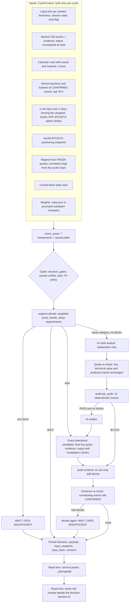

# Decision engine

How one analysis cycle turns stored inputs into a published decision per asset. Everything that decides a
category is deterministic Python. The AI only explains, and audits only by adding blocks, and it runs only for
setup categories. Numbers below are taken from the merged configuration (`config/rules.json` version 1.3.0 plus
`config/rules.d/*.json`, `market.json` 1.5.0). There is no `rules.d/technical.json`: level settings live under `technical` in
`rules.d/market.json`, and technical scoring constants under `scoring.technical` in `rules.json`.

Code: `backend/decision.py` (cycle, persistence), `scoring.py` (components, gates, text), `engines.py`
(`decide`, `confidence`, category helpers), `causal.py`, `analytics.py`, `technicals.py`, `positioning.py`,
`regime.py`, `macro.py`, `sessions.py`, `audit.py`, `refresh.py`, `notifications.py`, `calibration.py`,
`service.py`. The event-risk overlay (`event_risk.py`) sits beside published decisions and never feeds them (section 9).

## 1. Pipeline

`HubService._recalculate` builds one `CycleContext` and runs `decision.analyse` for every configured asset
under `analysis_lock`. Each payload is stored as a `Decision` row and published on the `decisions` stream.
`CycleContext` reads the published assets with `hub.assets(event_overlay=False)`, so the event-risk overlay is never an
input. It is added at read time to what the API serves (section 9).

## 2. Score components

`score = clamp(sum(value_k * weight_k for measured k), -100, 100)`, rounded to 2 dp. Every component is
`{value, status, basis}` with value in [-100, 100]. A missing component contributes 0 and its weight is **not**
redistributed, so with only `technical` measured |score| <= 15. Weights must sum to 1 within
`scoring.weight_sum_tolerance` (1e-6). The cycle uses `calibration.champion_weights`: `rules.json` weights unless a
validated weights challenger was promoted (see section 8).

| Component | Weight | Measures | Missing when |
|---|---|---|---|
| `event` | 0.30 | Sum over scorable events of `net_effect(active paths reaching symbol) * product(factors)` | No event is CONFIRMED, has a known causal trigger, has `first_seen_utc <= now` and has an active path reaching the symbol |
| `macro` | 0.20 | Released rows (actual present, 0-72 h old, `scoring.macro.max_age_hours`) mapped by `macro_trigger`: `net_effect * min(1, abs(z) / 3.0)` | No release with a z-score maps to a path reaching the symbol |
| `reaction` | 0.15 | Weighted mean of own reaction (0.6: expected sign x status score at the latest horizon of the selected event) and same-event basket confirmation (0.4: expected x pct), over the parts present | No eligible own reaction for the selected event; a different event's direction cannot orient the basket |
| `technical` | 0.15 | Level break: above resistance `60 + 20 * (price - R) / ATR`; below support `-60 - 20 * (S - price) / ATR`; inside range measured 0 (no ATR: extension 0) | No fresh live print of an open venue (`technicals.break_price`: a daily or derived close, a STALE quote, a closed or after-hours venue, a stub), or support/resistance absent or withheld after a data gap (`levels.state.reason` is the basis) |
| `positioning` | 0.08 | Sum of contrarian crowding points, capped at +/-40 (`positioning.component_cap`) | Not BTC/ETH, snapshot older than 900 s (`positioning.max_age_seconds`), or no options/futures rows |
| `cross_asset` | 0.07 | `own_sign * (aligned - opposed) / observed * 100` over assets linked by active paths; a move counts when beyond the asset's noise tolerance | Symbol's net causal expectation is 0, or fewer than 2 linked assets observed (`scoring.cross_asset.min_observed`) |
| `regime` | 0.05 | Mean over active non-MIXED regimes of `sign(exposure) * rule coverage`; only MIXED active is measured 0 | Regime posture absent or `INSUFFICIENT_DATA` |

Reaction status scores (`scoring.reaction.status_scores`): CONFIRMED 100, PARTIAL 50, NO_REACTION 0, DIVERGENT -50,
REVERSED -100. Horizons are the keys of `scoring.market_confirmation.horizon_weights`: 1m, 5m, 15m, 30m, 1h, 4h,
close, next_session.

**Event factors** (`scoring.event`). An unmeasured factor is 1.0 and listed in `unmeasured_factors`.

| Factor | Value |
|---|---|
| fact_confidence | `fact_confidence / 100` (always measured) |
| source_quality | `0.5 + 0.5 * q`; q = `event.source_quality` else max supporting evidence weight |
| novelty | `0.3 + 0.7 * novelty` |
| surprise | `clamp(1 + 0.15 * (abs(z) - 1.0), 0.8, 1.5)` |
| priced_in | `1 - 0.7 * priced_in` |
| persistence | `0.5 + 0.5 * max(rule persistence)` |
| market_confirmation | `0.5 + 0.5 * basket confirmation_pct / 100` (latest basket for that event) |

**Causal graph** (`rules.d/causal.json`, `causal_version` 2.0.0): 14 variable nodes, 17 rules, `max_depth` 7.
Each rule is a chain of steps. A step's cumulative transmission times the node's asset exposure gives the asset
sign and weight. Per path and asset:
`contribution = sign * transmission * strength * regime_multiplier * abs(exception_factor) * 0.5 ** (hours / half_life)`.
`regime_multiplier` is the product of the rule's `regime_dependencies` for active regimes, capped at 1.5. Exceptions
(`suppress`, `invert`, `scale`) fire on `regime_active`, `event_confirmed` or `posture`. A path is active when it is not
suppressed and `strength * decay >= 1` (`min_active_strength`). Hours count from `event_time` or `first_seen_utc`.
Competing rules for one trigger stay separate paths.

Triggers never come from an LLM (an AI extraction is only a proposal, see `accept_extraction`):
- `derive_trigger`: 13 keyword rules in config order, first match wins. Every `all` group needs a
  word-boundary phrase hit, any `none` phrase vetoes, and `sources` optionally restricts. Fallback
  `source_event_types` (fed/ecb to CENTRAL_BANK, bls to MACRO, sec to REGULATION) sets a type but no trigger.
- `macro_trigger`: needs a finite z-score and a US country. us-inflation (CPI/PCE/PPI) maps to
  INFLATION_HOT/COOL at |z| >= 1.0. us-payrolls maps to JOBS_STRONG/WEAK at 1.0. us-unemployment/claims maps up to
  JOBS_WEAK at 1.0. us-activity (GDP/ISM/PMI/retail sales, excluding "price") maps down only to GROWTH_SCARE at
  |z| >= 1.5. The z-score is `(actual - consensus) / stdev(own past surprises known at that time)`, and needs 20 past
  surprises (`thresholds.min_history`). Otherwise z is None and no trigger fires (`macro.py`, no lookahead via
  `actual_ingested_at`).
- `market_triggers`: BRENT or WTI change_pct >= 2.5 fires OIL_PRICE_SPIKE, and SP500 <= -2.0 fires
  RISK_OFF_SHOCK. The origin asset is excluded from its own path. Market paths feed `cross_asset`, the regime
  expectation, the conflict gate and the text, but not `event`.
- `build_context`: condition inputs are active regimes, posture and triggers of CONFIRMED events at most 24 h old.

**Reactions and baskets** (`analytics.py`, `rules.d/market.json`). Windows are 1m, 5m, 15m, 30m, 1h and 4h, with
`confirm_scale` 0.3, 0.5, 0.7, 0.85, 1.0 and 1.3, plus the session-bound `close` and `next_session` (`sessions.py`).
Tolerances (noise/confirm) by class: crypto 0.1/0.8 %, index 0.05/0.4 %, equity 0.1/0.8 %, fx 0.03/0.2 %,
commodity 0.1/0.8 %, bond 0.5/3 bp. Symbol overrides: DXY 0.03/0.2, VIX 1.0/4.0, GOLD 0.05/0.4.
- Status: below noise is NO_REACTION. With the expectation, it is CONFIRMED if >= confirm x scale, else PARTIAL.
  Against it, it is REVERSED if an earlier window aligned, else DIVERGENT.
- Eligible events are at most 5 days old (432000 s) with importance unmeasured or >= 0.3. The baseline is the
  last live tick known at `first_seen_utc`. Stub ticks never count.
- An event first seen more than 900 s after its publication time `event_time` (`reaction.max_publication_lag_seconds`)
  is never measured: a backfilled or late-ingested release was published long before the baseline, so the move after
  ingestion is not its reaction. An event without a publication time is measured as before.
- Basket: 17 default symbols plus the expected assets. `confirmation_pct = 100 * (CONFIRMED + 0.5 * PARTIAL) / measured`.
  The level is HIGH at >= 75 and MEDIUM at >= 40, graded only when >= 3 assets are measured. The divergence flag
  needs aligned >= 2 and aligned > diverging. Missing assets never confirm.
- The cycle uses reactions of CONFIRMED events first seen within 48 h (`decision.reaction_event_age_hours`). The
  basket used is the latest-window basket of the newest confirmed event that expects the symbol to move.
- Own reactions must belong to that basket's event. Without a basket, select the newest event by its baseline time,
  then its latest measured horizon. A longer horizon from an older event cannot displace it. Zero basket confirmation
  contributes zero: flat assets are not evidence of an opposite move. Daily closes, proxy classes and stub flags are
  excluded from reaction, anomaly and execution-outcome tick queries, including fixtures without a `-stub` provider suffix.

**Technical levels** (`technicals.levels`, `market.json technical`): 1-minute bars aggregated from live, non-stub
ticks over 2 days, retaining only bars whose minute has ended by the cycle time. When no forming bar exists, the last
completed bar is retained. Official daily closes never enter the minute-bar inputs of a decision or its asset page.
- Candidates: previous day and previous week high/low, UTC-day session high/low, 20d/50d ranges, and swing
  pivots (15-min bars, lookback 2, keep 5).
- With traded volume: VWAP and volume profile (24 bins, 70 % value area).
- BTC/ETH: the top 5 open-interest option strikes of the 2 nearest expiries.
- The shared `asset_levels` path selects support/resistance around the last completed minute close, or the previous
  completed daily close when minute data is absent. That fixed reference is recorded in `levels.reference`; the live
  quote is tested against these boundaries. A touched boundary is retained when no level exists beyond it. Selecting
  boundaries around the live quote itself would erase every breakout. ATR is the mean true range of the last 14 bars,
  and needs >= 20 bars.
- **The price tested** (`technicals.break_price`) is only a FRESH live print of a venue whose `market_status` is LIVE.
  A daily close (`data_class` DAILY_CLOSE / DERIVED_DAILY), a STALE quote, a LAST CLOSE / AFTER HOURS venue or a stub
  gives no price: the component is missing ("No fresh live price of an open market to test against the levels"),
  the score carries no technical part, and no "below support" reason, driver or confirmation text is built from a
  close. The cycle (`CycleContext._levels`, `decision.analyse`) and the asset page share this rule. Before 3 Oct 2026
  a DAILY_CLOSE equity quote was compared with the previous session's minute levels (MSFT 512.80 vs support 517.44:
  technical -100, score -15, "conviction 15/100" while the venue was closed).
- **Data gaps** (`technical.max_gap_seconds` 300, `min_fresh_bars` 15, `session_min_bars` 30, `min_day_coverage` 0.9;
  `technicals.levels_state`, `current_run`, `withhold`). Bars further apart than `max_gap_seconds` are not one
  series. The support/resistance pair is published only while the last completed bar ended at most `max_gap_seconds`
  ago and the current run (the trailing bars without such a hole) holds at least `min_fresh_bars` bars; otherwise
  `support`/`resistance` are None, `levels.state` says why (`ready` false, `reason` "No current minute bar: the last
  one ended 20.4 h ago ..." or "Levels rebuilding after a data gap: 3 of 15 current minute bars", `fresh_bars`,
  `reference_age_seconds`) and the pair that would have been selected is kept under `state.withheld` for inspection.
  The technical component is then missing with that reason, `briefs.level_state` is UNKNOWN and no LEVEL_BREAK alert
  or lean can come from those levels: the first cycles after a restart, a feed outage or a session open wait for 15
  current bars instead of calling a level crossed while the app was off a "breakout" (BTC 2 Oct 07:27 UTC: reference
  83,840 of 1 Oct 11:02, price 85,979, "BULLISH LEAN" with technical +100). The intraday ATR, the session range, VWAP
  and the volume profile use the current run only (a true range measured across a 20 h hole booked the whole move as
  one minute's range: ATR 41 -> 191). Session high/low, VWAP, point of control and value area become candidates only
  from `session_min_bars` bars (`session.formed`; a 3-bar "session low" was a support). A day aggregated from intraday
  bars (BTC/ETH, no stored daily bars) is a previous day/week only with at least `min_day_coverage` of the venue's
  minutes (`sessions.day_minutes`: 1440 for a 24/7 venue, the session length for an exchange), so 76 recorded
  minutes are not a "previous day". A short REST hole (a rate-limited poll, under 5 minutes) is not a gap.
- **Read time** (`HubService.assets`): the levels of a decision past its `expires_at` (`analysis_seconds` after
  `created_at`: the app was stopped or the cycle is late) are withheld the same way ("Decision expired: levels await
  the next analysis cycle"), so yesterday's levels never meet today's first quote in an alert or a brief line.
- **Closed venues** (`asset_levels(keep_closed=True)`, the asset page only): while the venue is closed and the last bar
  is the end of its latest session (`sessions.previous_close`), the pair anchored to that close is shown for reading,
  `state.ready` false, `state.basis` "last session". Nothing is tested against it: a closed venue has no break price.

**Positioning** (`positioning.py`, `market.json positioning.crowding`): PERP_FUNDING_HIGH (funding_8h >= 0.0005) is
-20, PERP_FUNDING_NEGATIVE (<= -0.0002) is +20, BASIS_RICH (front annualized basis >= 20 %) is -10, and
BASIS_BACKWARDATION (<= -5 %) is +10. Put/call and skew flags are descriptive (0 points), so calls vs puts never
set direction.

**Regime** (`regime.py`, `rules.d/regime.json` 1.2.0): features come from FRESH quotes only (price, change_pct, bp
change for bonds), plus the US10Y-US2Y curve, BAA10Y credit, and BTC:NASDAQ / BTC:GOLD correlations (>= 20 returns).
- A rule is ACTIVE when all its required conditions hold, and UNAVAILABLE when a required input is missing.
- Confidence is the satisfied share of required, supporting and confirmed-event conditions. It is rule coverage,
  not a probability.
- Fewer than 2 observed features (`min_observed_features`) gives `INSUFFICIENT_DATA`. Posture is DEFENSIVE or
  CONSTRUCTIVE when only that group is active, otherwise MIXED.
- Regime feeds four places: the `regime` component (via `scoring.regime.variables`), causal
  `regime_dependencies`/exceptions, the calibration comparables key, and the input snapshot.
- Correlation bars (`HubService.correlation_bars`): the one-minute bars of the correlation legs are read once per
  symbol (BTC serves both pairs). The cycle passes its own bars (`hub.regime(bars=...)`), so no leg is read twice.
  The display regime (`last_close=True`: dashboard, `/api/regime`, the event-risk snapshot) may reuse a read less than
  `regime.correlation_bars_cache_seconds` (15 s) old. Decision scoring never reuses it and always reads fresh.

**Derived fields** (shown, not scored): `evidence_confidence` (contribution-weighted fact confidence),
`market_confirmation` (horizon-weighted own/basket blend), `data_quality` (freshness 0.4, provider 0.2,
coverage 0.3, history 0.1), `drivers` (signed weighted contributions by driver).

## 3. Categories and thresholds

`thresholds`: lean 15, setup 30, strong 60. Bands are tested from the highest threshold down, using `abs(score) >= threshold`.

| Condition | Category (long / short) | Direction | Kind |
|---|---|---|---|
| any block | WAIT / DATA INSUFFICIENT | WAIT | wait |
| abs(score) >= 60 | STRONG LONG SETUP / STRONG SHORT SETUP | STRONG LONG / STRONG SHORT | setup |
| abs(score) >= 30 | LONG SETUP / SHORT SETUP | LONG / SHORT | setup |
| abs(score) >= 15 | BULLISH LEAN / WAIT / BEARISH LEAN / WAIT | same as category | lean |
| otherwise | WAIT | WAIT | wait |

Setup requirements (`categories.setup_requirements`). A setup band falls to the lean band (recorded in
`downgrades`, not a block) unless both hold:
- `technical` is measured with the same sign as the score. An inside-range 0 fails, giving
  "Technical confirmation absent or opposed".
- `event` or `macro` is measured, aligned with the score and has abs >= 20. Otherwise:
  "No aligned event/macro driver of at least 20".

`engines.is_setup(label)` is true for the four SETUP categories and their directions. `engines.category_side(label)`
is +1 for long setup/strong/lean labels, -1 for short, and 0 for WAIT variants. It drives the read-time downgrade,
the invalidation check and alerts. `decision.ai_for_categories` names the four SETUP categories. `audit_status`
is the audit result for setups, BLOCK for anything with a final block, and otherwise NOT_REQUIRED. SETUP alerts
(`notifications.setup_alert`) fire only for `audit_status == PASS`.

## 4. Gates that force WAIT

Any block makes the category WAIT / DATA INSUFFICIENT. The score is still computed and stored.

**Pre-decision blocks** (every asset; `scoring.decision_gates` plus `decision.analyse`; `scoring.gates` config):

| Reason | Condition |
|---|---|
| Critical data missing or stale | No quote, or `freshness_status != FRESH`: the latest tick is older than its provider's freshness limit, or it is a daily-close tick. **One lookup**, `config.freshness_seconds(provider, default)`: `market_data.freshness.providers` in `rules.d/market.json` (Finnhub 60 s, Alpaca 30 s: REST-polled feeds, whose quote is older than a stream's by construction, see the note's arithmetic: p95 vendor lag 31.5 s + 15 s poll + 8 s round = 54.5 s), every other provider (the one-second streams: Binance, Coinbase, Massive) the Settings default `quote_stale_seconds` 15 s; a limit is never above the provider's own `realtime_max_age_seconds` (120 s). `HubService.quote`, `_real_tick`, this gate, `audit.pre_audit`, `data_quality`, `analytics._tick_at` (reactions), `backtest.tick_as_of` and the runtime stream watchdog all read it; the quote carries the limit used as `freshness_threshold_seconds`, its age as `age_seconds`, and when STALE never keeps a stored "real-time" as-of label (`stale_labels`: "STALE: last price 14:59:25 UTC is older than the 60 s freshness limit"). A tick stamped up to `max_future_seconds` (5 s) after the cycle clock (exchange event time, a tick stored between the cycle taking its time and reading the quote) has age 0 and is FRESH; one further ahead is a clock problem and never fresh (its negative age is reported). Before 3 Oct 2026 one 15 s limit applied to every feed: a Finnhub quote is already 20 s old when stored, so US equities were FRESH 5 % of the session while the app polled (97.5 % with the provider limit, same stored ticks) and 893 of 1,130 in-session equity decisions of 30 Sep - 2 Oct carried this block (12 would). |
| Market closed or price unavailable | Quote FRESH but `market_status` not in `live_states` [LIVE] (`sessions.market_state`) |
| Non-live quote cannot confirm a decision | The quote is a daily close, a derived close or a stub (`technicals.is_live_quote`) |
| Major provider unavailable: X, Y | A feed that drives this score (quote provider, source of evidence on contributing events, `calendar` if macro measured) has status OFFLINE, AUTH_ERROR or RATE_LIMITED; X is the provider's display label and Y its plain status (offline, access rejected, rate limited) |
| High-quality sources contradict: ... | An event first seen within 6 h (`unverified_max_age_hours`) with any causal effect on the symbol is CONTRADICTED or FALSE |
| Important fact unverified: ... | Same window, status UNCONFIRMED or PARTIALLY_CONFIRMED, and the event is important (`scoring.important_unverified`, `scoring.gates` note_unverified): an assessed importance (tier weight x extractor rating) >= 0.5 (`min_importance`), or, while unassessed (importance null: the extractor has not rated it, was refused by the AI budget or does not run), an authoritative source with tier weight >= 0.9 (`unassessed_min_tier_weight`: tiers 1 and 2, official institutions and licensed wires). A missing rating alone never blocks: a tier-4 stock article with a keyword FED_HAWKISH trigger (0.5, "Why Is Intel Stock Falling") waits for its rating instead of blocking 28 assets for 1.5 h. **Reach** is an ACTIVE causal path of the event that contributes to the asset being decided now (`scoring._reaches`, the same test as the event component): a decayed path, or a trigger that does not map the asset (a crypto-regulation wire never blocks NVDA), does not reach it |
| Score based mainly on social rumors | Every supporting evidence item of every contributing event has kind social or anonymous |
| Competing causal paths leave X unresolved (...) | Active paths push the symbol both ways and `abs(net) / gross < 0.35` (`conflict_net_ratio`) |
| Development stub data cannot drive a decision | The quote's tick carries `stub` |
| Relative central-bank comparison unavailable (A vs B) | FX pair (6-letter `fx` symbol): both banks from `decision.fx_banks` need a state row with rate, yield_2y, expected_next_rate, as_of, and `verified` true (`analytics.relative_policy`). A and B are the banks' short names (`official_data.central_bank_meetings.banks`, e.g. "ECB vs Fed"), else the currency code |

**Publication path.** Every directional candidate, including a lean that requires no AI, re-reads its quote and
checks live eligibility, technical confirmation, expiry, evidence, invalidation and required providers before
persistence or streaming. A shared cycle snapshot may expire while earlier assets await remote analysis.
Any new block re-runs `decide`, which gives WAIT / DATA INSUFFICIENT and `audit_status` BLOCK.

The technical confirmation is checked differently for the two kinds of candidate:
- A **lean** (no AI prose is bound to the analysed price; `decision.lean_recheck`) recomputes the technical component
  at the re-read price. The same value, or a break still on the lean's side (deeper or shallower) that keeps the
  candidate's category, is accepted and the re-read values are adopted: the stored score, components, confirmation
  text, probability and quote belong to one price. A re-read price that would lift the lean into a setup band (which
  needs the AI path of the next cycle) keeps the lean as analysed. Only a lost confirmation (the price is back inside
  the range), a reversed one (a break against the lean) or a score that fell out of the lean band blocks with
  "Price confirmation changed before publication". Before 3 Oct 2026 the value had to be equal: on a one-second feed
  (BTC/ETH) a non-saturated lean changed value between the cycle start and the re-read and was practically never
  published (BTC 2 Oct 07:30 UTC: technical -63.67 analysed, -64.63 re-read, blocked).
- A **setup** keeps the strict rule (steps 2 and 4 below): the prose and the auditor's verdict cite the analysed price,
  so any change of the technical value or of the semantic input hash blocks.

Setups additionally run these AI checks in order:
1. The chief analyst returns nothing: "Chief analyst explanation unavailable". Its explanation (and the auditor's
   verdict) of the same setup is reused without an AI request for `decision.ai_reuse_seconds` (1800 s) while the
   symbol, category, direction, evidence set and configuration hash are the same. A hash also binds all input fields
   and values to their original roles and context; only quote timestamp and age are excluded. Cited numbers must
   still be present. A value occurring under another field cannot justify reuse (`decision.reusable`; `ai_reused`).
2. Quote re-read after the model answers. Not FRESH or not LIVE: "Critical quote unavailable after explanation".
   Technical value differs at the new price: "Price confirmation changed during analysis". The semantic input hash
   must also match the inputs sent to the chief analyst: "Analysis inputs changed during AI generation" otherwise.
   A timestamp/age-only refresh is accepted and updates the snapshot quote.
3. `audit.pre_audit` (12 checks below, with `max_future_seconds` default 5 s). The AI auditor runs only if there
   are no blocks and all 12 pass. `audit.combine` gives BLOCK on any deterministic failure, a missing AI audit
   ("AI auditor unavailable") or a non-PASS AI verdict (prefixed "AI auditor:"). The AI cannot turn a failure
   into PASS.
4. After the auditor's final await, re-read the quote, check its live eligibility, technical confirmation and the
   original semantic input hash, and run `publication_blocks` and the deterministic audit again. Expired decisions, changed evidence timestamps,
   crossed invalidation, unavailable feeds or changed prices block publication before persistence or streaming.
   Rejected contexts are not cached; both the audit and publication status report BLOCK. A price change blocks
   old prose even when the technical score is capped and the old price still occurs elsewhere in the inputs.

| Audit check | Passes when |
|---|---|
| fresh_prices | Quote FRESH, live data (`is_live_quote`) and timestamp age `-max_future_seconds`..the quote provider's freshness limit (`config.freshness_seconds`, the same lookup as the gate) at audit time; the detail names the limit used |
| valid_timestamps | No quote/event/evidence time more than `max_future_seconds` ahead; no evidence published after its ingestion by more than that |
| market_open | Quote `market_status == LIVE` |
| sources_attached | At least one contributing event, and every one has evidence with a URL |
| old_article_as_new | No supporting evidence older than `thresholds.max_evidence_age_hours` (24 h) |
| claim_beyond_source | Evidence ids cited by the explanation are a subset of the supplied ids |
| contradictions_visible | A CONTRADICTED event or contradicting evidence is mentioned ("contradict") in reasons |
| direction_matches_score | Actionable direction has `score * sign >= 30`, and STRONG exactly when `abs(score) >= 60` |
| probabilities_valid | Probability absent, NOT ENOUGH DATA, or p in [0, 1] with n >= `minimum_calibration` (200) |
| invented_numbers | Every number in explanation reasons/confirmation/invalidation appears in the inputs |
| timezone_conversion | Quote, decision and event timestamps are timezone-aware ISO |
| unverified_x_as_fact | No event whose evidence is all from social/anonymous sources |

**Read-time downgrade** (`HubService.assets` then `_downgrade`). The stored row is unchanged. The response is set to
direction WAIT, category WAIT / DATA INSUFFICIENT, `audit_status` BLOCK, with the reasons appended to both `reasons`
and `blocks`, so the trade-watch WHY section can explain the read-time invalidation.
- Any decision with `category_side != 0` (setups and leans) whose quote is missing, not FRESH or not LIVE:
  "Critical quote unavailable, stale or market closed".
- Every remaining directional decision, including leans with `audit_status == NOT_REQUIRED` (`publication_blocks`):
  - Older than `analysis_seconds` (Settings default 300 s): "Decision expired; awaiting recalculation".
  - Quote not FRESH: "Critical quote stale".
  - A snapshot event no longer CONFIRMED, or with a changed `last_updated_utc`: "Evidence changed or expired".
  - Price at or beyond `invalidation_level` against the side: "Price invalidation crossed".
  - Quote provider OFFLINE, AUTH_ERROR or RATE_LIMITED: "Critical market provider unavailable".

## 5. Fact verification

`engines.confidence(evidence, now, event_type)` is recomputed on every event read (`Ingestion.event`, at `utcnow()`),
so events age out without a write. Only CONFIRMED events are scored.

**Event importance** (0..1, `service.importance_fields`, recomputed on every read). The source-tier weight (tier 1:
1.0, 2: 0.9, 3: 0.7, 4: 0.5, 5: 0.2) is stored as `tier_weight`. Until the extractor has rated the event the
importance is **null** (`importance_basis` "not assessed"): nothing is guessed from the tier alone
(docs/LOGIC_FIXES_2026-09-29.md point 4). Once the extractor has run it is `tier_weight x potential_importance / 100`
(`importance_basis` "source tier x extractor importance"), so a trivial tier-1 release rated 5 by the extractor reads
0.05, not 1.0. Events enriched before `tier_weight` existed kept the tier weight as their importance and are read the
same way. An event with no tier weight at all gets no importance fields.

What changed with the product, and why. Until the UI audit the value was `max(tier weight, tier x extractor)`, which is
always the tier weight: every tier-1 item read 1.0 whatever the extractor said, although `importance_basis` claimed
"source tier x extractor importance". The product is kept because it is what the basis always stated and what the
thresholds below were meant to measure. With the AI budget most events stay unassessed for hours (or for good when the
extractor does not run), so every consumer must say what it does with a null: a null is never "important" and never
"minor" by itself. Every consumer of the value, with its threshold:

| Consumer | Threshold (config) | Effect of the product | Unassessed (null) |
|---|---|---|---|
| Setup gate "Important fact unverified" (`scoring.decision_gates`) | >= 0.5 (`scoring.gates.min_importance`) | An unverified tier-1 item rated < 50 (tier 3: < 72) no longer blocks setups | Blocks only from an authoritative source, `tier_weight >= 0.9` (`scoring.gates.unassessed_min_tier_weight`); tier 3-5 items wait for their rating |
| Reaction measurement (`analytics._eligible`) | >= 0.3 (`reaction.min_importance`) | A tier-1 item rated < 30 is not measured | Measured (a reaction is an observation, not a claim) |
| Event alerts (`notifications.event_alert`) | >= 0.5, high priority >= 0.8 (`alerts.event`) | Tier 1 needs >= 50 for an alert and >= 80 for high priority | No alert (`event_importance` None) |
| BREAKING_EVENT trigger (`refresh.detect_triggers`) | >= 0.6 (`refresh.triggers.breaking_min_importance`) | Read when an event is first seen, usually before extraction, so mostly the tier weight; CENTRAL_BANK_STATEMENT and the breaking event types do not depend on importance | No trigger by importance; the breaking event types still fire |
| Congress cadence (`refresh.congress_active`) | >= 0.6 (`refresh.congress.active_min_importance`) | A REGULATION / LEGISLATION item rated < 60 no longer keeps the 5-minute cadence | Not active |
| Major event in briefs (`briefs.is_major`) | >= 0.6 (`brief.major_event_importance`) | Tier 1 needs >= 60 | Not major; a brief lists an unassessed fact only with an identified asset impact (`briefs.relevant`, AFP-06) |
| Hot-topic research (`Runtime.research_hot_topics`) | >= 0.5 (`brief.min_event_importance` / 100); priority 0 from 0.8 (`refresh.hot_topics.urgent_min_importance`) | The urgent cut was a hard-coded 0.9 on the tier weight (tiers 1 and 2 always urgent); it is now configured at 0.8, so tier 1 rated >= 80 stays urgent | Not researched (null reads 0) |

An official central-bank statement (tier 1.0) that the extractor rates 80 or more therefore passes every threshold it
passed before (`tests/test_ui_audit_be1.py`); minor tier-1 items (a proclamation rated 5, a routine notice rated 20) no
longer count as important facts, alerts or triggers. The thresholds were not changed.

- **Window.** An item counts if `0 <= age <= max_age`, where age is measured from `published_at`, and it is not
  `discovery_only` (flagged, or received over untrusted transport).

  | Event type | Max evidence age |
  |---|---|
  | CENTRAL_BANK, FED_HAWKISH, FED_DOVISH, REGULATION | 72 h |
  | MACRO, INFLATION_HOT, INFLATION_COOL, JOBS_STRONG, JOBS_WEAK | 48 h |
  | SOCIAL_DISCOVERY | 6 h |
  | any other type | 24 h (`thresholds.max_evidence_age_hours`) |

- **Weight.** An administrator `trust_weight` override, else `source_weights[kind]` (`rules.d/sources.json`), else
  `unknown_kind_weight` 0.1. A disabled source gets 0. The result is clamped to [0, 1] and multiplied by 0.7
  (`second_hand_factor`) if the item is not direct.
  - Kind weights: official/official_statistics/central_bank 1.0, sec_filing/exchange 0.99, government 0.98,
    wire 0.97, company/company_ir 0.95, press 0.85, specialist 0.75, analyst 0.65, social 0.2, anonymous 0.1.
- **Independence groups.** Items group by the source's `independence_group`. A copy with `syndicated_from`/`origin`
  counts under its origin's group and is not direct, so it never adds a confirmation. Per group, the tier is the
  max undecayed weight, and the decayed value is the max of `weight * 0.5 ** (age_h / half_life[kind])`.
  - Half-lives: official/official_statistics/central_bank/sec_filing/exchange 720 h, government 336, wire/company/
    company_ir 72, press 48, specialist 36, analyst 24, social 6, anonymous 3, default 24.
- **Confidence.** `(1 - product(1 - decayed_g)) * 100`, then `* (1 - max contradicting weight)` if any item contradicts.
- **Status** (first match): FALSE if a direct official contradiction has weight >= 0.98. CONTRADICTED if any
  contradiction has weight >= 0.85. CONFIRMED if confidence >= 90 (`fact_confirmation`) and there is a direct
  official item or >= 2 groups with tier >= 0.85. PARTIALLY_CONFIRMED if any group has tier >= 0.75. Otherwise
  UNCONFIRMED.
- **Syndication, live path** (`ingestion.py` + `dedupe.syndicated`). A new document's first 600 chars
  (character 3-gram vector) are compared with documents from other sources on the same event. Cosine >= 0.9
  (`dedupe.syndication_similarity`) stores it with `direct=False` and `origin` set. The AI fact-checker can only mark
  evidence second-hand (lowering confidence). It can never confirm.
- **STALE.** The event has evidence, none of it discovery-only, and all of it lies outside the window. Confidence is 0
  by rule. The UI shows "not current (evidence outside the freshness window)" instead of a percentage. A STALE
  event neither scores nor blocks, is skipped by AI enrichment, and never triggers recalculation.

## 6. Recalculation cadence and immediate triggers

- **Regular.** `Runtime.analysis_loop` runs once at startup, then waits
  `RecalcRequests.next(next_interval('interpretation'))`, which is 300 s (`refresh.cadences.interpretation.seconds`).
  Celery beat, when enabled, schedules `hub.analyze` at the same 300 s. `inactive_seconds` (900) applies only when a
  caller passes `markets_active=False`, and none does.
- **Cycle status.** Every cycle (`HubService._recalculate`, also the admin recalculation) records its outcome in
  `asset_scores/analysis-status`: `last_attempt_at` (the cycle time, which every decision of the cycle carries as
  `created_at`), `last_success_at`, `last_error_type`, `failed_symbols`. A cycle fails when it raises or when every
  asset failed; one asset's failure keeps that asset's previous decision and never aborts the cycle. `/api/dashboard`
  serves `last_analysis` (the last success only; the morning brief and other jobs never advance it) and
  `analysis: {last_success_at, last_attempt_at, last_error_type, cadence_seconds, stale, failed_symbols}`. A cycle
  also records `running_since` when it starts and `last_success_completed_at` when a successful cycle ends. `stale`
  is true when the last attempt failed, or when more than 2 cadences (`ui.analysis_stale_cadences`) passed since the
  last successful cycle finished: the loop waits a full cadence after a cycle ends, so a slow cycle (AI explanations
  and audits) is not stale. While the next cycle runs it is stale only if it started more than 2 cadences after that
  finish (the app was stopped) or has itself run longer than 2 cadences (a hung cycle). `failed_symbols` lists the
  assets the last cycle could not recalculate (they keep their previous decision) and is empty otherwise. Before the
  first recorded cycle, the newest published decision time is the last success.
- **Sampling.** `Runtime.observe` builds `refresh.observe_state`. It runs after news, discovery, central-bank,
  breaking, release-source, social and calendar polls, and on every derived-metrics tick (5 s). The first state is a
  baseline and fires nothing. The state also carries the event-risk trigger state (`event_risk.trigger_state`), rebuilt
  in a worker thread at most every `refresh.interpretation.event_state_seconds` (15 s), published decision scores and
  market sessions. Every trigger found goes to two consumers: the analysis loop and the market interpretation.
- **Debounce.** The analysis `RecalcRequests` accepts only the 8 names in `triggers.analysis_triggers`. It accumulates
  requests and never starts a run less than 30 s (`triggers.min_interval_seconds`) after the previous one. All pending
  reasons drain into that run and are stored in `recalc_triggers` and published on the `recalculations` stream. The
  event-aware triggers that refresh only the interpretation are listed in section 9.

| Trigger | Fires when (`refresh.detect_triggers`, `refresh.triggers`) |
|---|---|
| CENTRAL_BANK_STATEMENT | New event of type CENTRAL_BANK or from a `central_bank_sources` source (checked before BREAKING) |
| BREAKING_EVENT | New event of type GEOPOLITICAL_ENERGY, BREAKING, CENTRAL_BANK, MACRO or OFFICIAL_RELEASE, or importance >= 0.6 |
| FACT_STATUS_CHANGE | Known event's verification status changed |
| MACRO_RELEASE | Calendar row with impact >= 5 (`watch.min_impact`) newly has an actual |
| LARGE_MOVE | 900 s window change reaches 1.5 % or 10 bp (bonds), where it was below before |
| TECHNICAL_BREAKOUT | Level state newly becomes ABOVE_RESISTANCE or BELOW_SUPPORT |
| CROSS_ASSET_DIVERGENCE | New DIVERGENCE alert key from the derived loop (kept between cycles), or a new post-event MARKET DIVERGENCE in the event-risk state (id `MARKET_DIVERGENCE:<event_id>`) |
| MARKET_OPEN_CLOSE | A session class (equity, bond, fx, commodity: `refresh.interpretation.session_classes`) switches between open and closed; both states must be known |

- **STALE events never trigger.** A new event that is already STALE, or an event turning STALE, is skipped: a
  backfilled release or a fact ageing out is not news. A STALE event becoming CONFIRMED again does fire
  FACT_STATUS_CHANGE.
- **Level state** (`briefs.level_state`). It is UNKNOWN without a FRESH quote or stored levels. It is
  ABOVE_RESISTANCE when `price > R + break_margin(R, ATR)`, BELOW_SUPPORT when `price < S - break_margin(S, ATR)`,
  and otherwise INSIDE_RANGE.
  - `notifications.break_margin = max(0.1 % * level, 0.25 * ATR)` (`alerts.level_break.min_break_pct`,
    `min_break_atr`). LEVEL_BREAK alerts use the same margin, so triggers and alerts agree and a price at a level
    does not flap.
  - The `technical` score itself uses a strict `price > R` / `price < S` with no margin.

## 7. Reproducibility (spec §52)

- **Configuration.** `config.rules()` merges `rules.json` and `rules.d/*.json` in name order. A fragment may not
  redefine a key. `content_hash` is the SHA-256 of the canonical JSON (sorted keys, compact) of the merged dict.
  Files are re-checked at most once per second. `rules()` returns a private copy per call; per-row and per-tick code
  (for example `analytics`, `event_risk` through `sessions.ruleset()`) reads `config.rules_view()`, one shared, deeply
  read-only view of the same merged rules, rebuilt only when a file changes.
  - A full copy is stored in `configuration_versions` under `"{rules version}:{content_hash[:16]}"`. It is written at
    startup (`HubService.initialize`) and on each `PUT /api/admin/config/{fragment}`.
  - That endpoint bumps the fragment's `*_version` and restores the previous file if the new config fails to load
    or the weights do not sum to 1.
- **Decision payload.**
  - `versions`: `rules` (1.2.0), `content_hash`, `causal` (2.0.0), `sources` (2.1.0), `weights` (`rules` or
    `autolearn`), `weights_candidate`, and `models` (AI role to model).
  - Also recorded: `ai_run_ids`, `rules_version`, `component_detail`, `blocks`, `downgrades`, and `basis_counts`
    (events, macro releases, reactions, bars).
  - Two timestamps: `created_at` (cycle time) and `decided_at`.
- **Input snapshot.** `input_snapshot` holds the asset, the quote (after re-check), the contributing events with
  their evidence, component values and statuses, levels, evidence ids, the basket, the regime (regimes, posture,
  confidence), the candidate category/direction/score, and the confirmation text.
  - `input_hash = sha256(json.dumps(input_snapshot, sort_keys=True, default=str))`.
  - `engines.decide(component_detail, blocks, weights)` under the recorded `content_hash` reproduces the score and
    category.
- **API.** `GET /api/decisions/{id}` returns the full payload. `GET /api/decisions/{id}/audit` returns
  `decision.audit_record` with these fields:
  - `decision_id` (`D-YYYYMMDD-<first 6 of id>`), `id`, `symbol`, `category`, `score`, `generated`
  - `based_on`, `versions`, `ai_models`, `auditor`, `input_hash`

## 8. Historical probability and calibration

`calibration.historical_probability` returns a probability only when all of the following hold. Otherwise it
returns `{status: "NOT ENOUGH DATA", n, minimum, reason}`, and the UI shows "Not enough data".
- A promoted champion exists for (symbol, `autolearn.report_horizon` 4h).
- The champion's `trained_through` is before the decision time.
- Comparable outcomes n >= 30 (`autolearn.min_comparable`). Comparables share symbol, horizon and score bucket
  (NEUTRAL, LEAN, SETUP, STRONG with sign) and regime posture, with the all-regime bucket as fallback.

The probability is computed at cycle time before the audit, and recomputed if the final score differs. So for
setups, `probabilities_valid` checks the value that will be published, and that check requires n >= 200.

The minimums before a champion can exist:

| Stage | Minimum |
|---|---|
| Fit a candidate | >= 200 training rows (`thresholds.minimum_calibration`), chronological 70/30 purged split |
| Validate | >= 200 out-of-sample rows. PASS needs all of these: Brier improvement 95 % lower bound > 0; ECE <= 0.1 (and <= champion + 0.05 when the champion is a model); false-positive rate and drawdown not worse; >= 2 regimes with >= 30 rows each and no negative regime |
| Promote | Manual only: `POST /api/admin/calibration/promote/{candidate_id}`, validation PASS, champion unchanged since validation |
| Live monitor | After >= 100 live observations, automatic rollback if Brier > validation + 0.02, FPR > +0.05, or hit rate < -0.05 |
| Inputs | z-scores and correlations need >= 20 observations (`min_history`) |

Weights challengers (`reaction-weighted`, `catalyst-weighted`) are scored in shadow and go through the same
paired out-of-sample test. A promoted one changes the live weights, recorded as `versions.weights = autolearn`.

## 9. Event-risk overlay

Code: `backend/event_risk.py`. Config: `rules.d/event_risk.json` and `rules.d/event_exposure.json` (both 1.1.0). The
full contract is [EVENT_AWARENESS.md](EVENT_AWARENESS.md). Every score below is a configured weighting on 0-100, never a
probability.

**Decisions never read the overlay.**
- `CycleContext` reads `hub.assets(event_overlay=False)`. Scoring, gates, the audit and the stored `Decision` row never
  see event risk.
- The overlay is applied at read time, after the read-time downgrade (section 4):
  - `HubService.assets()` (default `event_overlay=True`: `/api/assets`, the asset page) calls `event_risk.overlay`. It
    reads news and the calendar once and uses the latest regime stored by the cycle when it is at most 900 s old
    (`stored_regime_max_age_seconds`), else none. `event_risk.apply_assets` sets `event_risk` on each entry.
  - The dashboard builds `event_risk.snapshot` once with its display regime and applies the snapshot's
    `asset_event_risk` to its asset entries. Regime sensitivity can therefore differ slightly between the two.
- The published category, score and blocks are unchanged. The overlay adds `event_risk` `{score, level, event_id,
  minutes_until, phase, event_name, trade_status, adjusted_confidence, base_confidence, penalty, confidence_basis,
  awaiting_reopen, status_reason}` beside the decision.
- An overlay failure never breaks the endpoint: `event_risk` is null and `event_risk_error` carries a short reason.

**Relevance** of an event (`relevance.weights`):

| Component | Weight | Value |
|---|---|---|
| importance | 0.30 | Configured class prior (row or per-symbol override first; else 10 x vendor impact) |
| expected_volatility | 0.20 | Configured class prior |
| proximity | 0.15 | Curve on minutes until the event: <= 60 min 100, 360 min 75, 1440 min 40, 4320 min 10, 10080 min 0. RELEASED / IN_PROGRESS 100, POST_EVENT 80 to 20, verified unscheduled 100 to 50 over 24 h, date-only capped at 75 |
| regime_sensitivity | 0.15 | Mean exposure on the regime drivers, raised toward 100 when exposed drivers move |
| exposure_breadth | 0.10 | 100 x sum of exposure weights / 6 |
| pricing_uncertainty | 0.10 | From explicit outcome probabilities; 50 when market pricing is UNKNOWN |

Unlike decision scoring, a component that cannot be computed is left out and the weights are renormalised over the
measured ones (named in `relevance_missing`). An event that exposes no tracked asset is capped at 55
(`unmapped.relevance_cap`).

| Level | Relevance |
|---|---|
| CRITICAL | >= 90 |
| VERY HIGH | 75-89 |
| HIGH | 60-74 |
| MODERATE | 40-59 |
| LOW | < 40: hidden from the dashboard, still listed by `/api/events/upcoming` |

**Dominance** (`dominance.weights`): importance 0.25, expected volatility 0.15, proximity 0.20, affected count 0.10
(100 x affected assets / 10), pricing uncertainty 0.10, historical impact 0.10, regime sensitivity 0.10. Historical
impact is the mean stored T+1h impact of the class once 8 events are stored (`event_risk.record_history`, run by
`publish_briefs` after each cycle), else the class expected volatility. `dominant_event` is the highest score when it is
strictly above 75 (`dominance.threshold`). Unmapped events are capped like relevance.

**Per-asset event risk** = max over counted events of `relevance x (exposure_floor + (1 - exposure_floor) x w)`, with
`asset_risk.exposure_floor` 0.35 and `w` the asset's exposure weight (very_high 1.0, high 0.75, medium 0.5, low 0.25;
`event_exposure.levels`). An unexposed asset gets 0. Example: relevance 80 on a `high` asset gives
80 x (0.35 + 0.65 x 0.75) = 67.0 (HIGH).
- Counted events: RELEASED, IN_PROGRESS and POST_EVENT events, verified unscheduled events, and upcoming events within
  `asset_risk_horizon_minutes` (720). Unverified (potential) events never count.

**EVENT RISK MODE** (`risk_mode`) is active when any of these holds (date-only rows never qualify):
- a timed event RELEASED, IN_PROGRESS or 0-60 min away that is CRITICAL, or whose configured class importance is
  >= 90 (`importance_min`) and which exposes tracked assets;
- a RELEASED or IN_PROGRESS decision of FOMC, ECB, BOE or BOJ (`live_classes`) at CRITICAL or VERY HIGH (`live_levels`);
- a verified unscheduled CRITICAL event.

**Pre-event confidence penalty** (`adjustment`): `adjusted_confidence = base x (1 - penalty)` with
`base = |decision score|` (`base_confidence: abs_decision_score`; conviction, not a probability) and
`penalty = clamp((event_risk - 40) / (100 - 40), 0, 1) x 0.25` (`penalty_start` 40, `max_penalty` 0.25). Example:
event risk 70 gives penalty 0.125, so a decision score of 45 shows `adjusted_confidence` 39.4.

**Trade status** (`event_risk.trade_status`). The side is `category_side` of the published category after the read-time
downgrade.

| trade_status | When |
|---|---|
| WAIT FOR `<EVENT>` | Side != 0 and an exposing event is either a scheduled RELEASED / IN_PROGRESS event with asset event risk >= 45 (`in_progress_min_risk`), or timed and 0-60 min away (`wait_window_minutes`) with asset event risk >= 60 (`wait_threshold`). `<EVENT>` is the class short label (FED, CPI, AAPL EARNINGS) |
| CONDITIONAL LONG / SHORT | Side != 0, no wait, and any of: a lean category; `market_confirmation` < 50 (`confirmation_threshold`); top asset event risk >= 45 (`conditional_threshold`); the asset is exposed to a post-event MARKET DIVERGENCE. An unmeasured confirmation is not weak |
| LONG / SHORT | Side != 0 and none of the above |
| WAIT | Side 0 (WAIT, WAIT / DATA INSUFFICIENT, read-time downgrades) |

`awaiting_reopen` is true when the asset's session is not LIVE. `status_reason` lists why a status is WAIT FOR or
CONDITIONAL.

**Post-event reactions** (`post_event`) for timed events with relevance >= 40 while RELEASED, IN_PROGRESS or
POST_EVENT:
- Windows T+1m, 5m, 15m, 30m and 1h from the last live tick at or before the event time (at most 120 s old,
  `baseline_max_age_seconds`); each window tick at most 90 s old (`window_max_gap_seconds`).
- The expected direction comes from the resolved scenario only: a macro or earnings surprise needs consensus and
  actual; a central bank needs a validated AI classification backed by an official document (EVENT_AWARENESS.md §8).
- Market confirmation is the basket confirmation at the latest graded window, with >= 2 measured exposed assets
  (`min_measured`).
- MARKET DIVERGENCE when more than half (`divergence_share` 0.5) of them are DIVERGENT or REVERSED. It never starts a
  trade: exposed assets with a side turn CONDITIONAL, CROSS_ASSET_DIVERGENCE fires, and the runtime starts one
  research-planner request per event (`refresh.divergence_research`).

**Triggers: decisions versus interpretation.** `Runtime.observe` sends every trigger to two `RecalcRequests`: the
analysis loop accepts `refresh.triggers.analysis_triggers` (30 s debounce); the market interpretation accepts
`refresh.interpretation.triggers` (600 s debounce; every 1800 s on the cadence, 3600 s while traditional markets are closed; an unchanged AI basis is kept up to `unchanged_max_age_seconds`, 3 h). Event-window, regime and score triggers only refresh the
interpretation: decisions carry the overlay at read time, and a score trigger that re-ran decisions would feed itself
(`triggers.note_analysis_triggers`).

| Trigger | Re-runs decisions | Refreshes the interpretation |
|---|---|---|
| BREAKING_EVENT, CENTRAL_BANK_STATEMENT, LARGE_MOVE | yes | no |
| MACRO_RELEASE, TECHNICAL_BREAKOUT, FACT_STATUS_CHANGE, CROSS_ASSET_DIVERGENCE, MARKET_OPEN_CLOSE | yes | yes |
| EVENT_CRITICAL_NEW (an event newly CRITICAL) | no | yes |
| EVENT_WINDOW_60, EVENT_WINDOW_15 (a timed CRITICAL / VERY HIGH / HIGH event enters the 60 or 15 min window) | no | yes |
| EVENT_RELEASED, PRESS_CONFERENCE_START (an event or its press conference moves from a pre-release phase to RELEASED or later) | no | yes |
| REGIME_CHANGE (posture changed) | no | yes |
| LARGE_SCORE_CHANGE (a published score moved >= 15, `triggers.large_score_change`) | no | yes |

## Known gaps (code as of this revision)

- `engines.syndicated_from` / `attribution_origin` (`verification.syndication`, `verification.attribution`) are
  exercised only by tests. Live ingestion uses `dedupe.syndicated`.
- No calendar source fills `market_pricing`. Every event's pricing is UNKNOWN, so the overlay's pricing uncertainty is
  always the default 50 and FOMC / ECB / BoE / BoJ always list `MARKET PRICING UNKNOWN` (EVENT DATA INCOMPLETE at
  CRITICAL or VERY HIGH).
- The market interpretation runs only in the API process (`Runtime.interpretation_loop`); there is no Celery task for
  it.

Resolved after the first review of this document:
- `probabilities_valid` now sees the published probability. It requires `n >= min_comparable` (30) *and* a champion
  validated on `>= minimum_calibration` (200) observations.
- `old_article_as_new` uses the same per-event-type windows as fact verification.
- `sources_attached` accepts official macro releases (provider plus release time) as sources, so macro-only setups can pass.
- The derived loop records DIVERGENCE alert keys, so CROSS_ASSET_DIVERGENCE fires once per new divergence.
- `ai_disputed_evidence` on a contributing event blocks the decision ("Fact-checker disputes evidence").
- Every analysis cycle records the configuration it uses in `configuration_versions`, including hand edits.

Resolved by the logic audit of 2-3 Oct 2026 (decision and data core; `tests/test_logic_core.py`):
- Levels anchored to bars older than `technical.max_gap_seconds`, or to fewer than `min_fresh_bars` current bars, are
  withheld (section 2 "Data gaps"): no first-cycle "breakout" lean, LEVEL_BREAK alert or brief level line after a
  restart (10 of the 32 leans stored 25 Sep - 2 Oct sat on a reference 12-32 h old; 15 of 289 LEVEL_BREAK alerts had no
  tick in the 5 minutes before them). The intraday ATR, session range and previous day are gap-aware.
- Only a fresh live print of an open venue is tested against the levels (`technicals.break_price`); a daily close
  never scores a level break.
- A tick up to `max_future_seconds` ahead of the cycle clock has age 0 and is FRESH (34 BTC/ETH decisions of 27 Sep -
  2 Oct were STALE at an age of -0.33..-0.01 s).
- One freshness lookup per provider (`config.freshness_seconds`): Finnhub 60 s, Alpaca 30 s, streams 15 s; the
  as-of label never says real-time for a STALE verdict.
- The "Important fact unverified" gate never blocks on a missing rating (`unassessed_min_tier_weight`), and only through
  an active causal path to the asset decided.
- A lean is published while its price confirmation still holds in the same direction (`decision.lean_recheck`).
- `HubService.initialize` runs the ingestion layer's start-up repair of stored events (`run_event_repair`) after the
  sources are stored, logged, never fatal; `enrich_event` prepares a specialist request only when the AI budget would
  send it (`budget_refuses`), so a refused macro specialist is not retried on every enrichment.
